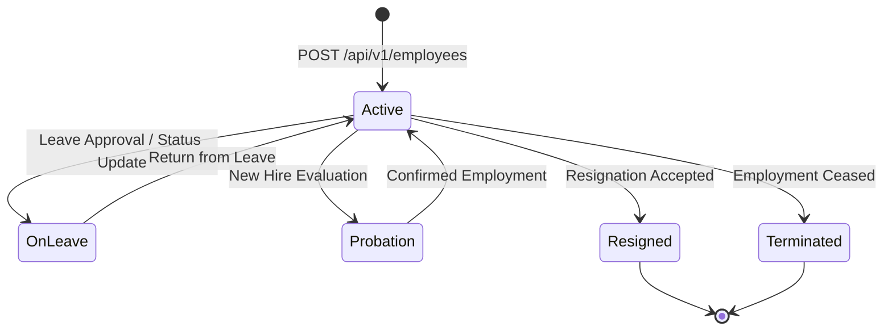
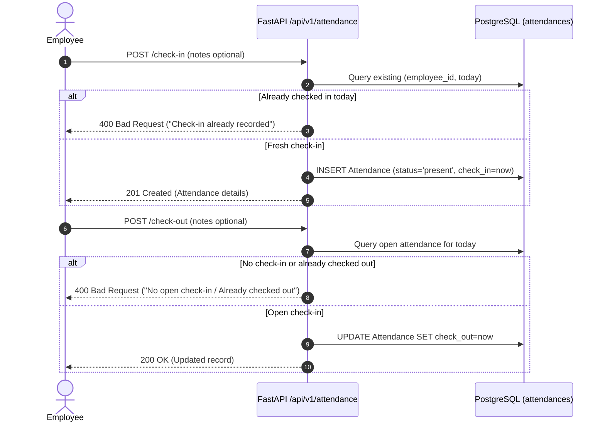

# Employee Management Workflow
## Champions Club Sports Club Management System

**Module:** `backend/app/modules/employees/`  
**Purpose:** Manages club staff profiles, organizational hierarchies (departments and designations), and daily time & attendance records.

---

## 1. Architectural Overview

The Employee Management subsystem establishes a secure internal profile for sports coaches, kitchen chefs, pro-shop attendants, receptionists, and administrative personnel. It provides:
- Decoupled employment profile tracking without duplicating login credentials.
- Optional one-to-one linkage to `User` accounts via a unique, nullable `user_id` foreign key.
- Granular organizational grouping through `departments` and `designations`.
- Daily check-in/check-out attendance tracking with club timezone (`Asia/Kolkata`) compliance.
- Audited HR attendance corrections with mandatory justification reasons.

---

## 2. Employee Lifecycle

### 2.1 Profile Fields & Validation
- `employee_code`: Unique uppercase identifier (e.g. `EMP-001`). Rejects duplicate codes with `HTTP 409 Conflict`.
- `work_email`: Unique lowercase email. Rejects duplicates with `HTTP 409 Conflict`.
- `user_id`: Unique nullable foreign key to `users.id`. Prevents two employees from linking to the same login account.
- `department_id` & `designation_id`: Explicit relational foreign keys (`ON DELETE SET NULL`) ensuring employee profiles remain intact if departments change.

---

## 3. Time & Attendance Workflow

### 3.1 Attendance Corrections
- Authorized HR Staff and Owner can correct timestamps or statuses (`present`, `half_day`, `absent`, `on_leave`) via:
  `PUT /api/v1/attendance/{id}/correct`
- Mandatory `correction_reason` (minimum 5 characters) and reviewer identity (`corrected_by_id`) ensure complete audit compliance.
