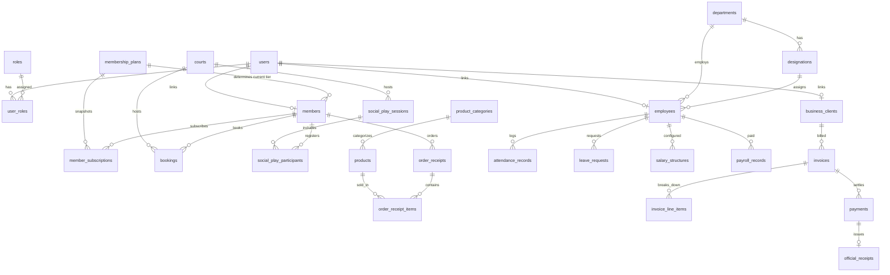

# CHAMPIONS CLUB — FINAL DATABASE RELATIONSHIPS & SCHEMA
## Relational Schema Reference for PostgreSQL 18

---

### Key Entities & Integrity Constraints

#### 1. Identity & RBAC
- **`users`**: Primary authentication entity with `id`, `email` (unique), `hashed_password`, `full_name`, `phone`, `token_version` (integer incremented upon logout for instant server-side revocation), and `is_active`.
- **`roles`**: System roles (`owner`, `receptionist`, `member`, `shop_staff`, `cafeteria_staff`, `hr_staff`, `account_staff`, `business_client`).
- **`user_roles`**: Many-to-many junction table between `users` and `roles`.

#### 2. Memberships & Subscriptions
- **`membership_plans`**: Master tier catalog (`Gold`, `Silver`, `Junior`) storing `monthly_fee`, `duration_days`, and tiered percentage discounts (`court_discount_percent`, `shop_discount_percent`, `bar_discount_percent`).
- **`members`**: Active member registry. Foreign key to `users.id` (optional, allowing walk-in members as well as online self-service members).
- **`member_subscriptions`**: Immutable audit ledger of all purchases and renewals. Stores immutable snapshots (`plan_name_snapshot`, `duration_days_snapshot`, `court_discount_snapshot`, `shop_discount_snapshot`, `bar_discount_snapshot`, `price_paid`, `subscription_status`, `payment_status`).

#### 3. Courts & Reservations
- **`courts`**: Sports facilities (`badminton`, `tennis`, `squash`, `table_tennis`) storing `hourly_rate`, `walk_in_rate`, and `is_active`.
- **`bookings`**: Standard 60-minute reservations from 06:00 to 22:00 in 30-minute intervals. Enforces conflict prevention, member discounts, or walk-in guest records.
- **`social_play_sessions`**: Organized Friday social group play with `court_id`, `start_time`, `end_time`, `max_capacity`, `fee_per_participant`, and `status`.
- **`social_play_participants`**: Participant registrations linked to `members.id`.

#### 4. Commerce & Cafeteria
- **`product_categories`**: Categorizes products for Pro-Shop and Cafeteria with `module_type` (`shop` or `cafeteria`).
- **`products`**: Sellable inventory items with `sku` (unique), `unit_price`, `tax_rate`, `current_stock`, `reorder_threshold`, and `module_type`.
- **`order_receipts`**: Retail POS and Cafeteria orders storing `order_type`, `payment_method`, `total_amount`, `tax_amount`, and preparation status (`pending`, `preparing`, `ready`, `served`).
- **`order_receipt_items`**: Line items with `product_id`, `quantity`, `unit_price`, `tax_rate`, and `subtotal`.

#### 5. Human Resources & Payroll
- **`departments`**: Functional units (`Front Desk Operations`, `Sports & Facilities`, `Retail & Dining`, `Human Resources`, `Finance`).
- **`designations`**: Job titles within departments.
- **`employees`**: Internal staff profile optionally linked to `users.id`, with `employee_code`, `work_email`, `joining_date`, and `employment_status`.
- **`attendance_records`**: Daily employee check-in and check-out logs.
- **`leave_requests`**: Employee leave applications with approval workflow (`pending`, `approved`, `rejected`).
- **`salary_structures`**: Base salary and allowances configured per employee.
- **`payroll_records`**: Processed monthly salary payments and payslips.

#### 6. Finance & Corporate Administration
- **`business_clients`**: Corporate accounts storing `company_name`, `contact_person`, `email`, `phone`, `tax_id_gstin`, and `credit_limit`.
- **`invoices`**: Accounts receivable ledger storing `invoice_number`, `client_id`, `total_amount`, `amount_paid`, `due_date`, and status (`draft`, `issued`, `paid`, `cancelled`).
- **`invoice_line_items`**: Itemized invoice line items with quantity, unit price, and line totals.
- **`payments`**: Payment records with `payment_method`, `amount`, and `payment_date`.
- **`official_receipts`**: Numbered financial receipts issued upon payment settlement.
