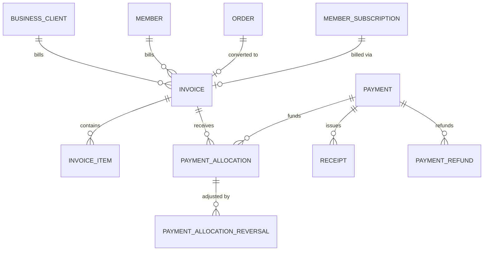

# Champions Club — Financial Architecture & Integrity Framework (Milestone E)

This document provides the authoritative financial design, entity relationships, allocation mathematical models, and concurrency safeguards implemented in Milestone E of the Champions Club Sports Club Management System.

---

## 1. Core Architecture Principles

1. **Explicit Legal Obligations (Invoices) vs. Cash Inflows (Payments):**
   - An **Invoice** represents a legal debt or billed revenue obligation.
   - A **Payment** represents actual, confirmed liquid money received into the club's bank account or front-desk cash drawer.
   - Fulfilling an order, serving a meal, or booking a court does not mark an invoice paid. Only a confirmed payment allocated to that invoice transitions it to `paid`.

2. **No Polymorphic Foreign Keys:**
   - To guarantee PostgreSQL referential integrity and avoid orphaned records, polymorphic combinations (`reference_type` + `reference_id`) are forbidden.
   - Invoices hold typed, explicit foreign keys:
     - `order_id` (FK -> `orders.id`)
     - `subscription_id` (FK -> `member_subscriptions.id`)
     - `business_client_id` (FK -> `business_clients.id`)
     - `member_id` (FK -> `members.id`)
     - `walk_in_name`, `walk_in_phone` (for walk-ins without accounts)

3. **Immutable Amount-Based Allocation Reversals:**
   - Allocation reversals do not use boolean flags (`is_reversed = true`).
   - Reversals are tracked as immutable rows in `payment_allocation_reversals` with an explicit `amount`.
   - Partial refunds/reversals adjust the effective net allocated amount:
     $$\text{net\_allocated(allocation)} = \text{allocation.allocated\_amount} - \sum \text{reversal.amount}$$
   - Example: An original ₹1,000 allocation followed by a ₹400 reversal results in ₹600 net allocated and restores ₹400 to the invoice's outstanding balance.

4. **Separation of Receipts from Allocation Statements:**
   - A **PaymentReceipt** (`receipts`) is generated strictly once per successful payment to acknowledge total money received.
   - An **Allocation Statement** represents how that single payment was split among multiple invoices. Corporate bulk payments never generate duplicate receipts.

---

## 2. Entity Relationship Diagram (ERD)

---

## 3. Financial Formulas & Derivations

### 3.1 Authoritative Invoice Balance Derivation
An invoice's `amount_paid` is derived from the allocation and reversal ledger:
$$\text{amount\_paid(invoice)} = \sum_{\text{alloc} \in \text{invoice}} \left( \text{alloc.allocated\_amount} - \sum_{\text{rev} \in \text{alloc}} \text{rev.amount} \right)$$
$$\text{outstanding\_amount(invoice)} = \max(0, \text{invoice.total\_amount} - \text{amount\_paid})$$

### 3.2 Invoice Status Transitions
$$\text{invoice\_status} = \begin{cases} 
\text{'issued'}, & \text{amount\_paid} = 0 \\
\text{'partially\_paid'}, & 0 < \text{amount\_paid} < \text{total\_amount} \\
\text{'paid'}, & \text{amount\_paid} \ge \text{total\_amount}
\end{cases}$$

### 3.3 Payment Balances & Unallocated Capacity
$$\text{net\_allocated(payment)} = \sum_{\text{alloc} \in \text{payment}} \left( \text{alloc.allocated\_amount} - \sum_{\text{rev} \in \text{alloc}} \text{rev.amount} \right)$$
$$\text{unallocated\_balance} = \text{payment.amount} - \text{net\_allocated(payment)} - \sum \text{refunds.amount}$$

---

## 4. Concurrency & Deadlock Protection

When executing payment allocations:
1. **Deterministic Lock Order:** Transactions always lock the `Payment` row first using `SELECT ... FOR UPDATE`, followed by the `Invoice` row using `SELECT ... FOR UPDATE`.
2. **ACID Allocation Validation:** Inside the transaction, the service verifies that:
   - `alloc_amount <= unallocated_payment`
   - `alloc_amount <= outstanding_invoice`
3. Two concurrent allocation requests competing for the same balance are serialized. The second transaction reads the committed balance and receives an HTTP 409 Conflict if funds or balance are exhausted.
