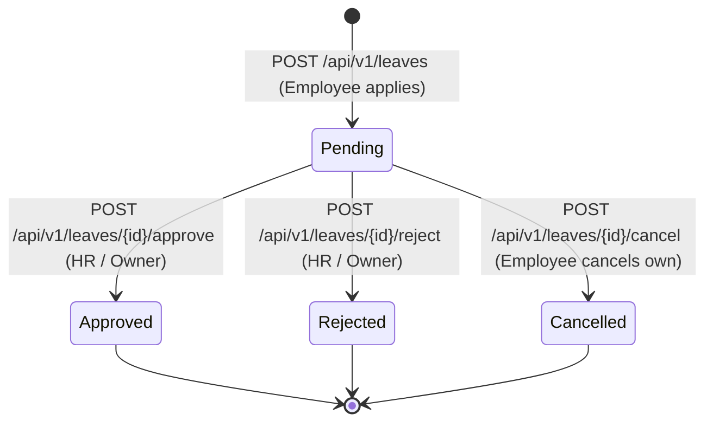

# Leave Management Workflow
## Champions Club Sports Club Management System

**Module:** `backend/app/modules/employees/`  
**Purpose:** Governs employee leave applications, temporal overlap conflict checks, self-service cancellation, and administrative review.

---

## 1. Lifecycle State Machine

---

## 2. Validation & Business Rules

1. **Date Sequence Integrity**:
   - Evaluated at schema and database level: `end_date >= start_date`.
   - Violations rejected with `HTTP 400 Bad Request`.
2. **Day Count Derivation**:
   - `days_count = (end_date - start_date).days + 1` stored as `Numeric(4, 1)` with `CheckConstraint("days_count > 0")`.
3. **Temporal Overlap Rejection**:
   - An employee cannot have two active leave applications for the same dates:
     $$\text{existing.start\_date} \le \text{new.end\_date} \quad \text{AND} \quad \text{existing.end\_date} \ge \text{new.start\_date}$$
   - Overlaps with `status in ('pending', 'approved')` are rejected with `HTTP 409 Conflict`.
4. **Self-Approval Prohibition**:
   - An employee possessing HR permissions cannot approve their own leave request (`HTTP 400 Bad Request`). Another authorized administrator must review it.
5. **Finality Safeguards**:
   - Once a leave request reaches `approved`, `rejected`, or `cancelled`, further state mutations are rejected with `HTTP 400 Bad Request`.
