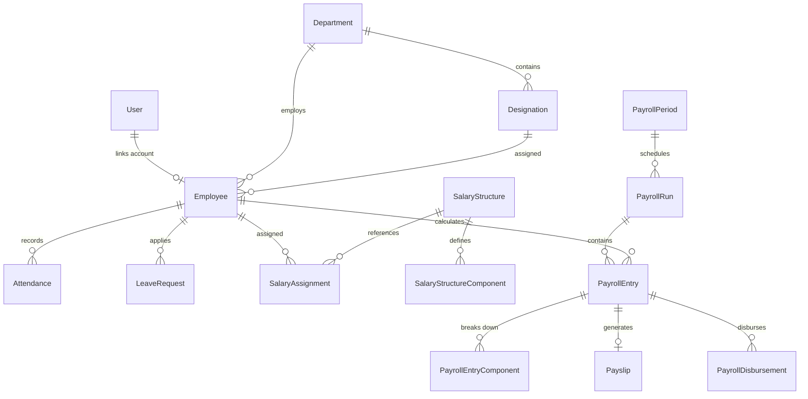

# Milestone F — Pre-Implementation Architectural Audit
## Employee Management, HR, Payroll & Leave Management

**Project:** Champions Club Sports Club Management System  
**Date:** November 2026  
**Status:** Pre-Implementation Architectural Audit Approved  
**Author:** Senior Backend & Database Architect  

---

## 1. Executive Summary

Milestone F introduces comprehensive human resources and staff payroll capabilities to the Champions Club modular monolith. Following the successful delivery of Milestones A through E (Authentication & RBAC, Memberships, Court Bookings, Shop & Inventory, and Customer Finance), Milestone F handles the club's internal workforce operations:
- Employee profiles, departments, and designations.
- Time and attendance tracking with check-in/check-out and HR audit corrections.
- Leave management lifecycle (application, overlap conflict validation, approval/rejection).
- Configurable salary structures and historical salary assignments.
- Batch payroll processing with immutable snapshotting and status progression (`draft` $\rightarrow$ `reviewed` $\rightarrow$ `processed` $\rightarrow$ `paid`).
- Explicit payroll disbursement financial integration (ensuring operating expenses are decoupled from customer receivables).
- Secure employee self-service payslip access and granular RBAC protections.

---

## 2. Audit of Existing Codebase & Findings

### 2.1 Existing Models & Architecture
1. **Existing Models:** 25 SQLAlchemy models across 5 domain modules (`auth`, `members`, `courts`, `bookings`, `shop`, `finance`).
2. **Current Alembic Revision:** `173afe035458` (`add_finance_and_business_client_tables`).
3. **Database State:**
   - Development database (`champions_club`) contains 94 members, 59 courts, 47 bookings, 3 users, 6 roles, 3 plans. Zero data loss or corruption permitted.
   - Test database (`champions_club_test`) contains isolated test schema passing 132 automated tests.
4. **Existing Authentication & RBAC:**
   - Canonical `RoleEnum` in `app.modules.auth.models`: `owner`, `receptionist`, `member`, `shop_staff`, `hr_staff`, `business_client`.
   - The `hr_staff` role was established in Milestone A and is fully supported by `require_roles([RoleEnum.HR_STAFF, RoleEnum.OWNER])`.
   - `User` model supports nullable one-to-one extensions (`member_profile`, etc.) with `token_version` invalidation.

### 2.2 Answers to Mandatory Audit Questions

| Audit Question | Architectural Finding | Technical Decision for Milestone F |
|---|---|---|
| **1. Does the existing project already define an Employee model or employee-related fields?** | No. No employee table or employee attributes exist in the database or ORM registry. | Create a dedicated `employees` table and ORM model in `app.modules.employees.models`. |
| **2. Is employee information connected to User through a one-to-one relationship?** | Currently no. Users represent authenticated login credentials. | Add `user_id` with `UNIQUE` constraint and `ForeignKey("users.id", ondelete="SET NULL")` on `employees`. Allows unlinked staff records before invitation acceptance. |
| **3. Are there existing attendance requirements?** | The core spec states "Staff work in shifts...". Phase 4 outlines check-in/check-out, daily records, and HR corrections. | Implement `attendances` table with unique constraint on `(employee_id, attendance_date)`, tracking check-in, check-out, and HR audit correction reasons in `Asia/Kolkata` timezone. |
| **4. Are salary structures expected to be configurable?** | Rule 2.1 strictly forbids hardcoded or invented tax/PF/overtime rates. | Implement configurable `salary_structures` and `salary_structure_components` where earnings and deductions are dynamically configured by authorized HR/Owner. |
| **5. Are leave policies already specified?** | The core spec notes "leave to approve". Specific leave quotas are not hardcoded. | Implement `leave_requests` supporting configurable leave types (`casual`, `sick`, `annual`, `unpaid`), strict date sequence validation (`end_date >= start_date`), and overlap prevention. |
| **6. Does the existing finance module support payroll disbursements?** | Milestone E models (`invoices`, `payments`, `receipts`) represent customer receivables and inflows. | Operating payroll is an expense liability. We must NOT mix payroll with customer revenue invoices or receipts. |
| **7. Can payroll obligations and disbursements be represented without treating payroll as customer revenue?** | Yes, by establishing dedicated payroll obligation (`payroll_runs`, `payroll_entries`) and disbursement models (`payroll_disbursements`). | Implement explicit payroll disbursement models that credit cash/bank and debit payroll payable without touching customer revenue tables. |
| **8. Which existing models/services can safely be reused?** | `User`, `Role`, `RoleEnum` (auth); `Base`, `get_db` (core database); `settings` (core config); `require_roles`, `get_current_user` (dependencies). | Full reuse of core dependencies; no duplication of auth or database mechanics. |

---

## 3. Proposed Module Structure

All Milestone F functionality will reside in a dedicated, modular domain package:

```text
backend/app/modules/employees/
├── __init__.py          # Exports router and service
├── models.py            # SQLAlchemy 2.x models for HR, attendance, leaves, payroll
├── schemas.py           # Pydantic v2 validation contracts
├── service.py           # ACID business logic, concurrency locks, state machines
└── routes.py            # FastAPI REST API endpoints under /api/v1
```

---

## 4. Proposed Database Schema & Entity Relationships



### Table Definitions
1. **`departments`**: `id` (UUID PK), `name` (String unique), `description`, `is_active`, timestamps.
2. **`designations`**: `id` (UUID PK), `department_id` (FK), `title` (String), `description`, `is_active`, timestamps.
3. **`employees`**: `id` (UUID PK), `user_id` (FK unique nullable), `department_id` (FK), `designation_id` (FK), `employee_code` (String unique), `first_name`, `last_name`, `work_email` (String unique), `phone`, `joining_date`, `employment_status`, `employment_type`, `address`, `emergency_contact`, timestamps.
4. **`attendances`**: `id` (UUID PK), `employee_id` (FK), `attendance_date` (Date), `check_in` (DateTime), `check_out` (DateTime nullable), `status` ('present', 'half_day', 'absent', 'on_leave'), `notes`, `corrected_by_id` (FK), `correction_reason`, timestamps. UQ: `(employee_id, attendance_date)`.
5. **`leave_requests`**: `id` (UUID PK), `employee_id` (FK), `leave_type`, `start_date`, `end_date`, `days_count` (Numeric), `reason`, `status` ('pending', 'approved', 'rejected', 'cancelled'), `reviewed_by_id` (FK), `review_remarks`, `applied_at`, `reviewed_at`.
6. **`salary_structures`**: `id` (UUID PK), `name` (String unique), `description`, `is_active`, timestamps.
7. **`salary_structure_components`**: `id` (UUID PK), `salary_structure_id` (FK), `component_name`, `component_type` ('earning', 'deduction'), `default_amount` (Numeric(10,2)).
8. **`salary_assignments`**: `id` (UUID PK), `employee_id` (FK), `salary_structure_id` (FK), `base_salary` (Numeric(10,2)), `effective_from` (Date), `is_active`, `notes`, `created_by_id` (FK), `created_at`.
9. **`payroll_periods`**: `id` (UUID PK), `period_name` (String unique), `start_date`, `end_date`, `is_closed`, `created_at`.
10. **`payroll_runs`**: `id` (UUID PK), `payroll_period_id` (FK), `run_number` (String unique), `status` ('draft', 'reviewed', 'processed', 'paid', 'cancelled'), `total_gross`, `total_deductions`, `total_net` (Numeric(12,2)), `notes`, `processed_by_id` (FK), `processed_at`, timestamps.
11. **`payroll_entries`**: `id` (UUID PK), `payroll_run_id` (FK), `employee_id` (FK), `employee_name_snapshot`, `employee_code_snapshot`, `department_snapshot`, `designation_snapshot`, `gross_earnings`, `total_deductions`, `net_payable`, `amount_disbursed`, `payment_status` ('unpaid', 'partially_paid', 'paid'), timestamps. UQ: `(payroll_run_id, employee_id)`.
12. **`payroll_entry_components`**: `id` (UUID PK), `payroll_entry_id` (FK), `component_name`, `component_type`, `amount` (Numeric(10,2)).
13. **`payslips`**: `id` (UUID PK), `payslip_number` (String unique), `payroll_entry_id` (FK unique), `employee_id` (FK), `generated_at`.
14. **`payroll_disbursements`**: `id` (UUID PK), `payroll_entry_id` (FK), `disbursement_reference` (String unique), `idempotency_key` (String unique nullable), `amount` (Numeric(10,2)), `disbursement_method` ('bank_transfer', 'upi', 'cash', 'cheque'), `disbursement_date` (Date), `disbursed_by_id` (FK), `notes`, `created_at`.

---

## 5. API Endpoint Specifications

All endpoints conform to `/api/v1/` route prefixes:

### 5.1 Departments & Designations (`/api/v1/departments`, `/api/v1/designations`)
- `POST /api/v1/departments`: Create department (Owner, HR).
- `GET /api/v1/departments`: List active departments (Owner, HR, Staff).
- `PUT /api/v1/departments/{id}`: Update department (Owner, HR).
- `POST /api/v1/designations`: Create designation (Owner, HR).
- `GET /api/v1/designations`: List designations with optional `?department_id=` (Owner, HR, Staff).

### 5.2 Employees (`/api/v1/employees`)
- `POST /api/v1/employees`: Create employee profile (Owner, HR).
- `GET /api/v1/employees`: List employees with search and department filtering (Owner, HR).
- `GET /api/v1/employees/{id}`: Detailed employee record (Owner, HR).
- `PUT /api/v1/employees/{id}`: Update employee details (Owner, HR).
- `PATCH /api/v1/employees/{id}/status`: Change employment status (Owner, HR).
- `GET /api/v1/employees/me`: Authenticated employee self-service profile (Any authenticated linked employee).

### 5.3 Attendance (`/api/v1/attendance`)
- `POST /api/v1/attendance/check-in`: Authenticated employee daily check-in.
- `POST /api/v1/attendance/check-out`: Authenticated employee check-out on open attendance record.
- `GET /api/v1/attendance/me`: Authenticated employee attendance history.
- `GET /api/v1/attendance`: Administrative attendance log by date/employee (Owner, HR).
- `PUT /api/v1/attendance/{id}/correct`: Administrative attendance correction with mandatory reason (Owner, HR).

### 5.4 Leaves (`/api/v1/leaves`)
- `POST /api/v1/leaves`: Submit leave application (Authenticated employee).
- `GET /api/v1/leaves/me`: List personal leave history (Authenticated employee).
- `GET /api/v1/leaves`: List club-wide leave applications (Owner, HR).
- `GET /api/v1/leaves/{id}`: View leave details (Owner, HR, or applying employee).
- `POST /api/v1/leaves/{id}/approve`: Approve pending leave (Owner, HR).
- `POST /api/v1/leaves/{id}/reject`: Reject pending leave with remarks (Owner, HR).
- `POST /api/v1/leaves/{id}/cancel`: Cancel own pending leave (Applying employee).

### 5.5 Salary Structures & Revisions (`/api/v1/payroll/salary-structures`)
- `POST /api/v1/payroll/salary-structures`: Create structure template with components (Owner, HR).
- `GET /api/v1/payroll/salary-structures`: List active structures (Owner, HR).
- `POST /api/v1/payroll/employees/{employee_id}/salary`: Assign or revise employee salary (Owner, HR).
- `GET /api/v1/payroll/employees/{employee_id}/salary`: View salary revision history (Owner, HR).

### 5.6 Payroll Runs & Payslips (`/api/v1/payroll`)
- `POST /api/v1/payroll/periods`: Create payroll period (Owner, HR).
- `GET /api/v1/payroll/periods`: List payroll periods (Owner, HR).
- `POST /api/v1/payroll/runs`: Calculate payroll run in `draft` status (Owner, HR).
- `GET /api/v1/payroll/runs`: List payroll runs (Owner, HR).
- `GET /api/v1/payroll/runs/{id}`: View detailed run entries and calculation breakdown (Owner, HR).
- `POST /api/v1/payroll/runs/{id}/review`: Transition status from `draft` to `reviewed` (Owner, HR).
- `POST /api/v1/payroll/runs/{id}/process`: Finalize payroll run, generate immutable payslips (Owner, HR).
- `POST /api/v1/payroll/entries/{id}/disburse`: Record payment disbursement against payroll entry (Owner, HR).
- `GET /api/v1/payroll/me/payslips`: Self-service view of finalized personal payslips (Authenticated employee).
- `GET /api/v1/payroll/me/payslips/{id}`: Detailed view of personal payslip with itemized earnings/deductions (Authenticated employee).

---

## 6. Financial Integration & Concurrency Safeguards

1. **Decoupled Payroll Obligations:**
   - Payroll runs create operational payable obligations (`PayrollEntry.net_payable`).
   - Customer revenue accounts remain untouched.
2. **Disbursement Safeguards:**
   - Overpayment rejected: $\sum \text{disbursements} \le \text{entry.net_payable}$.
   - Row-level lock: `SELECT ... FOR UPDATE` on `PayrollEntry` before inserting disbursement record.
   - Idempotency key prevents duplicate network retry disbursements.
   - Status transitions automatically:
     - `amount_disbursed == 0`: `unpaid`
     - `0 < amount_disbursed < net_payable`: `partially_paid`
     - `amount_disbursed == net_payable`: `paid`
   - When all entries in a run are `paid`, `PayrollRun.status` updates to `paid`.

---

## 7. Security & RBAC Matrix

| Role | Employee Directory | Attendance | Leaves | Salary Structures | Payroll Processing | Disbursements | Self-Service |
|---|---|---|---|---|---|---|---|
| **Owner** | Full | Full | Approve/Reject/View | Full | Full | Full | Yes |
| **HR Staff** | Full | Full | Approve/Reject/View | Full | Full | Full | Yes |
| **Employee (Linked User)** | View Self Only | Check-In/Out, View Self | Apply, Cancel Self | Forbidden | Forbidden | Forbidden | Profile, Leaves, Payslips |
| **Receptionist** | Forbidden | Forbidden | Forbidden | Forbidden | Forbidden | Forbidden | Forbidden |
| **Shop Staff** | Forbidden | Forbidden | Forbidden | Forbidden | Forbidden | Forbidden | Forbidden |
| **Member** | Forbidden | Forbidden | Forbidden | Forbidden | Forbidden | Forbidden | Forbidden |
| **Business Client** | Forbidden | Forbidden | Forbidden | Forbidden | Forbidden | Forbidden | Forbidden |

---

## 8. Migration & Testing Strategy

1. **Alembic Migration G:**
   - Parent revision: `173afe035458`.
   - Generates all 14 HR tables with foreign key constraints, indexes, and check constraints.
   - Verified on both `champions_club` and `champions_club_test`.
2. **Automated Test Suite:**
   - Dedicated test file: `backend/tests/test_hr_and_payroll.py`.
   - Comprehensive test fixtures in `conftest.py`: `hr_user`, `hr_headers`, `employee_user`, `employee_headers`.
   - Full regression test run across Milestones A, B, C, D, E, and F.

---

## 9. Conclusion
The architecture is completely specified, robust against race conditions, strictly non-polymorphic, and compliant with all engineering mandates. We proceed immediately to Phase 2 (Implementation).
