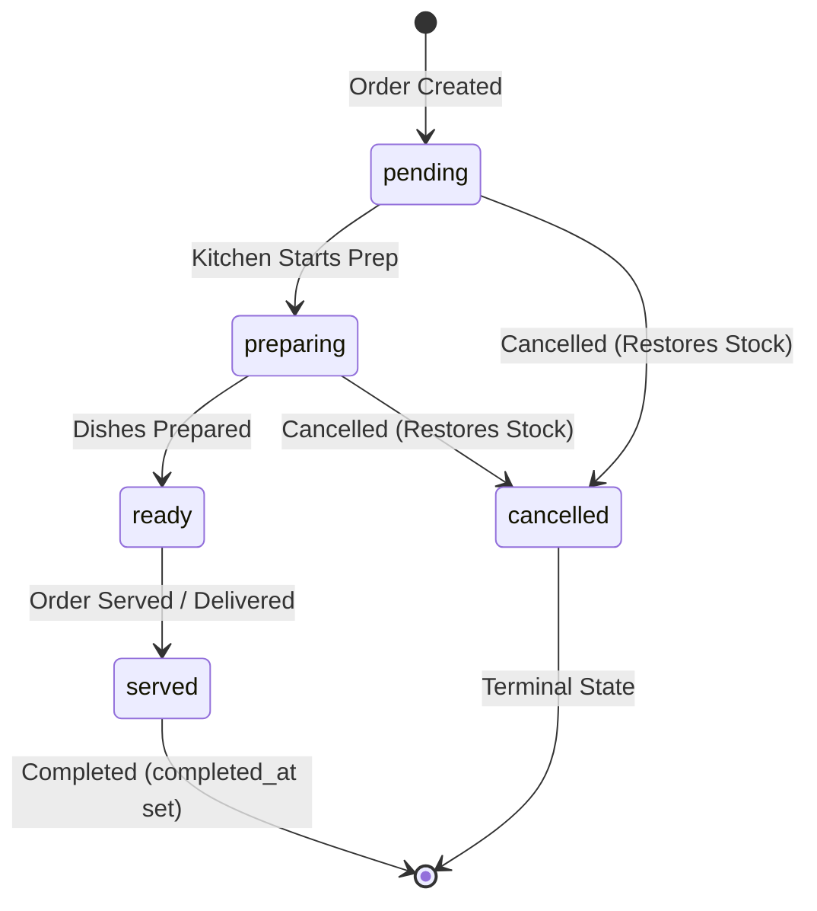
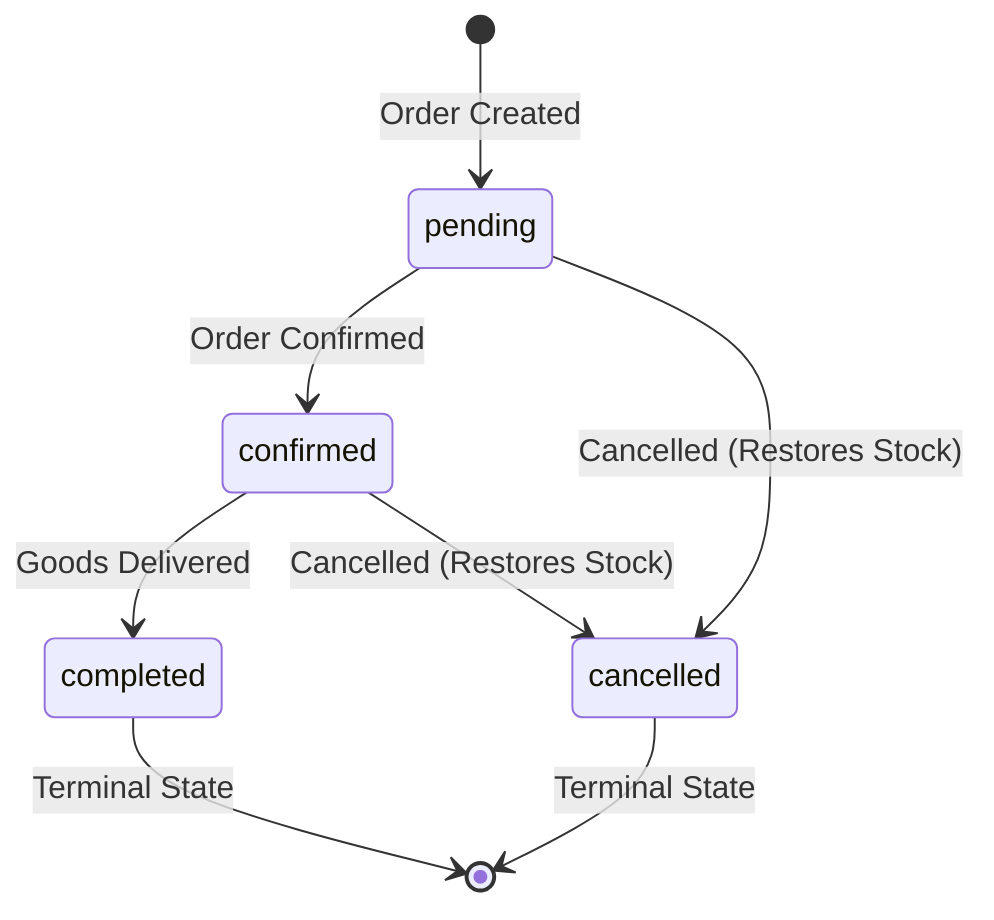
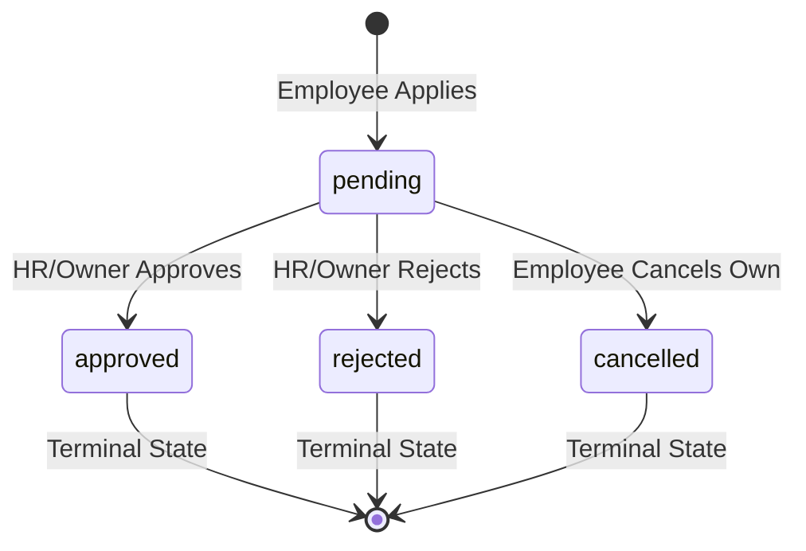
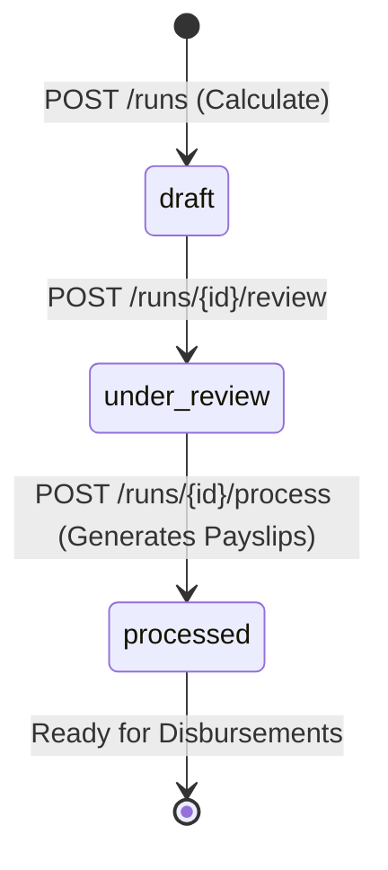
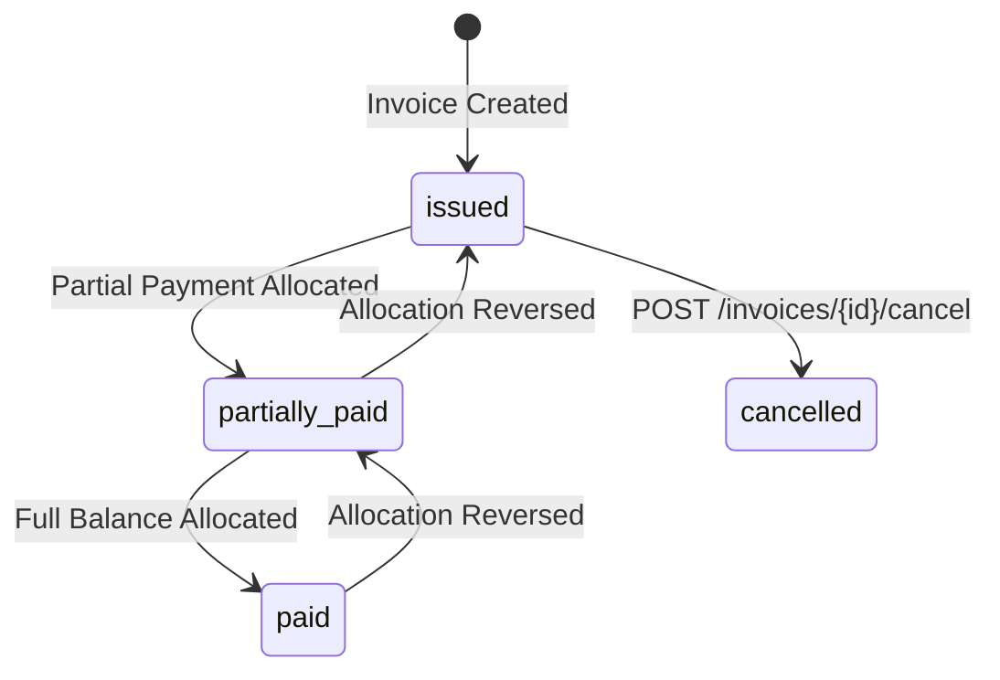

# Champions Club Sports Club Management System
## Milestones H5 + H6: Pre-Implementation API Mapping Validation & Security Audit

> **Document Version**: 2.0 (Authoritative Backend Ground Truth)
> **Scope**: Complete Pre-Implementation Verification for Milestones H5 + H6
> **Target Frontend Stack**: React 19 / Vite 6, JavaScript ES6+, Tailwind CSS v4, Axios, React Router v6
> **Backend Source Monolith**: FastAPI, SQLAlchemy 2.x, PostgreSQL 18, Pydantic v2
> **Total Endpoints Verified**: **126 of 126 Endpoints** (100% Monolith Coverage)
> **Verification Commit**: `67f75d6771de508167f53761c721be80a4c51646`

---

## Executive Summary

This audit provides the final, authoritative architectural and security contract required prior to constructing the React frontend operational modules (Milestones H5 and H6). It addresses and definitively resolves five critical discrepancies identified in earlier integration proposals, verifies the security and object ownership constraints for every endpoint, and inventories all 126 backend endpoints registered in `backend/app/main.py`.

### Primary Audit Takeaways

1. **Shop Product Price/Tax Permissions (`PUT /products/{id}`)**: Shop staff CANNOT modify `unit_price` or `tax_rate`. The backend explicitly raises `403 Forbidden` unless the user has the `owner` role. Furthermore, current stock is NOT an editable field in `ProductUpdate`; all inventory changes must pass through audited inventory endpoints (`/adjust` or `/restock`).
2. **Cafeteria Order Terminal State**: The exact final lifecycle state for cafeteria orders is **`served`** (NOT `completed`). `completed` is an invalid status in cafeteria schemas and will cause validation failures. Moreover, orders in `ready` status **CANNOT** be cancelled; cancellation is only permitted when an order is in `pending` or `preparing`.
3. **Employee Self-Service Identity Resolution**: Self-service endpoints (`/attendance/check-in`, `/attendance/check-out`, `/attendance/me`, `/leaves`, `/leaves/me`, `/employees/me`, `/payroll/me/payslips`) map callers via `Employee.user_id == current_user.id`. Any authenticated user without a linked `Employee` record receives `404 Not Found: 'No employee profile is linked to this authenticated user account.'`.
4. **Payroll & Payslip Isolation**: There is NO standalone `GET /payroll/entries/{entry_id}` endpoint. Payroll run entries are accessible only to `owner` and `hr_staff` within `PayrollRunResponse`. Employees access their compensation exclusively through `GET /payroll/me/payslips` and `GET /payroll/me/payslips/{id}`, where strict ownership checks prevent IDOR cross-inspection.
5. **Payment & Subscription Ledger Integrity**: Creating or renewing subscriptions (`POST /members/{id}/subscriptions`, `POST /members/{id}/renew`) and creating bookings (`POST /bookings`) creates operational records with `payment_status='unpaid'`; **neither endpoint fabricates payment or receipt records**. Cash collections, invoices, allocations, and refunds are decoupled and governed by strict double-entry ledger rules.

---

## 1. Resolution of Critical Architectural Discrepancies

### 1.1 Discrepancy A: Shop Product Update Permissions & Stock Manipulation
**Backend Source Reference**: `backend/app/modules/shop/routes.py` (lines 131–155), `backend/app/modules/shop/schemas.py` (lines 56–67), `backend/app/modules/shop/service.py` (lines 105–135).

#### Code Inspection & Verification
The endpoint `PUT /api/v1/shop/products/{product_id}` is protected by `require_roles([RoleEnum.OWNER.value, RoleEnum.SHOP_STAFF.value])`. However, within the route handler, field-level authorization is enforced:
```python
# backend/app/modules/shop/routes.py:145-150
user_roles = [r.name for r in current_user.roles]
if (prod_in.unit_price is not None or prod_in.tax_rate is not None) and RoleEnum.OWNER.value not in user_roles:
    raise HTTPException(
        status_code=status.HTTP_403_FORBIDDEN,
        detail="Only club owners are permitted to modify product pricing or tax rates.",
    )
```
Furthermore, inspection of `ProductUpdate` schema reveals:
```python
# backend/app/modules/shop/schemas.py:56-66
class ProductUpdate(BaseModel):
    name: Optional[str] = Field(None, min_length=1, max_length=150)
    description: Optional[str] = None
    sku: Optional[str] = Field(None, max_length=50)
    category_id: Optional[UUID] = None
    unit_price: Optional[Decimal] = Field(None, ge=0, decimal_places=2)
    tax_rate: Optional[Decimal] = Field(None, ge=0, le=100, decimal_places=2)
    discount_eligible: Optional[bool] = None
    is_active: Optional[bool] = None
    inventory_tracked: Optional[bool] = None
    reorder_threshold: Optional[int] = Field(None, ge=0)
```
#### Definitive Ground Truth Rules for Frontend:
1. **Pricing and Tax Rates**: Only users with the `owner` role may modify `unit_price` or `tax_rate`. In the UI, these form inputs must be disabled or hidden for `shop_staff` users.
2. **General Product Fields**: `shop_staff` CAN modify `name`, `description`, `sku`, `category_id`, `discount_eligible`, `is_active`, `inventory_tracked`, and `reorder_threshold`.
3. **Stock Quantities**: Neither `owner` nor `shop_staff` can update stock counts through `PUT /products/{id}`. The schema contains no stock fields. Any inventory modifications must be performed through:
   - `POST /api/v1/shop/inventory/adjust` (Requires `quantity_change: int`, `reason: str` [min 3 chars]).
   - `POST /api/v1/shop/inventory/restock` (Requires `quantity_added: int`, `unit_cost: Decimal`, `supplier_name: str`).

### 1.2 Discrepancy B: Cafeteria Order Lifecycle & Cancellation Constraints
**Backend Source Reference**: `backend/app/modules/shop/models.py` (lines 252–260), `backend/app/modules/cafeteria/schemas.py` (lines 32–34), `backend/app/modules/cafeteria/routes.py` (lines 131–168), `backend/app/modules/shop/service.py` (lines 670–767).

#### Code Inspection & Verification
In the database model (`backend/app/modules/shop/models.py`), cafeteria orders follow a specialized kitchen lifecycle. The transition dictionary is defined in `backend/app/modules/shop/service.py`:
```python
# backend/app/modules/shop/service.py:718-724
VALID_CAFETERIA_TRANSITIONS = {
    "pending": ["preparing", "cancelled"],
    "preparing": ["ready", "cancelled"],
    "ready": ["served"],
    "served": [],
    "cancelled": [],
}
```
In `backend/app/modules/cafeteria/schemas.py`:
```python
class CafeteriaStatusUpdate(BaseModel):
    new_status: str = Field(..., pattern="^(preparing|ready|served|cancelled)$")
    notes: Optional[str] = Field(None, max_length=255)
```
And in `cancel_order` (`backend/app/modules/shop/service.py:673-677`):
```python
if order.order_status in ("completed", "served"):
    raise HTTPException(
        status_code=status.HTTP_400_BAD_REQUEST,
        detail=f"Cannot cancel order in '{order.order_status}' status.",
    )
```
#### Definitive Ground Truth Rules for Frontend:
1. **Exact Final State**: The terminal completion state is **`served`**. The value `completed` is an invalid status in cafeteria endpoints. Submitting `completed` will trigger a `422 Unprocessable Entity` validation error.
2. **Ready Status Cancellation Prohibition**: Once kitchen staff mark an order as `ready`, it **CANNOT** be cancelled. Its only allowed transition is `served`. Attempting to cancel a `ready` order triggers `400 Bad Request: Invalid cafeteria order transition from 'ready' to 'cancelled'. Allowed: ['served']`.
3. **Permitted Cancellations**: Orders may only be cancelled from `pending` or `preparing`. When cancelled, inventory stock for tracked items is atomically restored via `InventoryMovement` (`movement_type='cancellation_restore'`) using deadlock-free row locking.
4. **Completion Timestamp**: When the status reaches `served`, the backend sets `completed_at = utc_now()`.

### 1.3 Discrepancy C: Employee Self-Service Identity Resolution & RBAC
**Backend Source Reference**: `backend/app/modules/employees/service.py` (lines 281–293), `backend/app/modules/employees/routes.py` (lines 171–178, 248–272, 305–320, 335–360, 510–528).

#### Code Inspection & Verification
All employee self-service endpoints rely on FastAPI dependency `get_current_user` and map the authenticated user account to an employee record using `get_employee_by_user_id`:
```python
# backend/app/modules/employees/service.py:281-293
def get_employee_by_user_id(db: Session, user_id: uuid.UUID) -> Employee:
    stmt = (
        select(Employee)
        .options(joinedload(Employee.department), joinedload(Employee.designation))
        .where(Employee.user_id == user_id)
    )
    emp = db.execute(stmt).scalar_one_or_none()
    if not emp:
        raise HTTPException(
            status_code=status.HTTP_404_NOT_FOUND,
            detail="No employee profile is linked to this authenticated user account.",
        )
    return emp
```
#### Self-Service vs Administrative RBAC Matrix:
| Action | Endpoint | Authorized Roles | Access Scope / IDOR Boundary | Non-Employee Behavior |
|---|---|---|---|---|
| **View Own Profile** | `GET /api/v1/employees/me` | Any Authenticated User | Resolves linked `Employee` record | Returns `404 Not Found` |
| **Self Check-In** | `POST /api/v1/attendance/check-in` | Any Authenticated User | Records punch for linked employee | Returns `404 Not Found` |
| **Self Check-Out** | `POST /api/v1/attendance/check-out` | Any Authenticated User | Closes open punch for linked employee | Returns `404 Not Found` |
| **My Attendance History** | `GET /api/v1/attendance/me` | Any Authenticated User | Returns attendance rows for linked employee | Returns `404 Not Found` |
| **Apply for Leave** | `POST /api/v1/leaves` | Any Authenticated User | Creates leave request for linked employee | Returns `404 Not Found` |
| **My Leave History** | `GET /api/v1/leaves/me` | Any Authenticated User | Returns leave rows for linked employee | Returns `404 Not Found` |
| **Cancel Own Leave** | `POST /api/v1/leaves/{id}/cancel` | Any Authenticated User | Can only cancel own leave while `pending` | Returns `404 Not Found` / `403` if not owner |
| **View Single Leave** | `GET /api/v1/leaves/{id}` | Any Authenticated User | `owner`/`hr_staff` see all; others restricted to own leave (`403` on mismatch) | `404` or `403` |
| **My Payslips** | `GET /api/v1/payroll/me/payslips` | Any Authenticated User | Returns payslip history for linked employee | Returns `404 Not Found` |
| **My Payslip Details** | `GET /api/v1/payroll/me/payslips/{id}` | Any Authenticated User | `owner`/`hr_staff` see all; others restricted to own payslip (`403` on mismatch) | `404` or `403` |
| **Admin Attendance List** | `GET /api/v1/attendance` | `owner`, `hr_staff` | All club attendance records with query filters | Returns `403 Forbidden` |
| **Admin Attendance Correction**| `PUT /api/v1/attendance/{id}/correct`| `owner`, `hr_staff` | Modifies check-in/out timestamps with audit note | Returns `403 Forbidden` |
| **Admin Leave Approval/Reject**| `POST /api/v1/leaves/{id}/[approve|reject]`| `owner`, `hr_staff` | Reviews pending leave applications | Returns `403 Forbidden` |

### 1.4 Discrepancy D: Payroll Run Visibility, Entry Access & Payslip Privacy
**Backend Source Reference**: `backend/app/modules/employees/routes.py` (lines 394–543), `backend/app/modules/employees/service.py` (lines 910–960).

#### Code Inspection & Verification
1. **Salary Structure & Assignment Privacy**: All endpoints for creating/listing salary structures (`/payroll/salary-structures`) and creating/viewing employee salary assignments (`/payroll/employees/{id}/salary`) require `require_roles([RoleEnum.OWNER, RoleEnum.HR_STAFF])`. Regular staff and employees have zero access to baseline salary configurations.
2. **Absence of Standalone Payroll Entry Endpoint**: There is **no endpoint** matching `GET /api/v1/payroll/entries/{entry_id}`. The line-item earnings and deductions breakdown for a payroll run is retrieved exclusively via:
   - `GET /api/v1/payroll/runs/{run_id}`: Returns `PayrollRunResponse` which contains `entries: List[PayrollEntryResponse]`. Each entry includes its nested `components: List[PayrollEntryComponentResponse]`.
   - This route is strictly restricted to `owner` and `hr_staff`.
3. **Employee Payslip Access**: Employees inspect their monthly net earnings and breakdown via:
   - `GET /api/v1/payroll/me/payslips`
   - `GET /api/v1/payroll/me/payslips/{payslip_id}`
   In `service.get_payslip_by_id`, non-admin callers are strictly checked against `payslip.employee_id == emp.id`. If a user attempts to view a payslip belonging to another employee, the backend raises `403 Forbidden: 'You can only access your own payslips.'`.
4. **Disbursement Authorization**: Only `owner` and `hr_staff` may disburse salary payments via `POST /api/v1/payroll/entries/{entry_id}/disburse`.

### 1.5 Discrepancy E: Payment & Subscription Ledger Integrity Rules
**Backend Source Reference**: `backend/app/modules/members/service.py` (lines 306–388), `backend/app/modules/bookings/service.py` (lines 201–217), `backend/app/modules/shop/models.py` (lines 252–267), `backend/app/modules/finance/service.py` (lines 145–160, 375–454, 505–582, 584–656, 661–719).

#### Code Inspection & Verification
1. **Subscription Purchases & Renewals Do Not Create Payments**:
   - `POST /api/v1/members/{member_id}/subscriptions` and `POST /api/v1/members/{member_id}/renew` create a `MemberSubscription` record with `payment_status='unpaid'` (unless explicitly set).
   - **Neither endpoint inserts a record into the `payments`, `invoices`, or `payment_receipts` tables**.
   - Membership fees must be billed via `POST /api/v1/invoices` (referencing `subscription_id`), and settled via `POST /api/v1/payments` and `POST /api/v1/payments/{id}/allocations`.
2. **Court Booking Creation Does Not Imply Payment**:
   - `POST /api/v1/bookings` calculates the member-discounted or walk-in fee (`calculated_fee`), verifies temporal availability, and inserts a `Booking` record with `status='confirmed'`.
   - It does not collect money or record financial ledger entries. Payment collection must occur through front-desk invoicing/payments.
3. **Decoupled Order Status vs Payment Status**:
   - Every retail and cafeteria order maintains two separate status fields: `order_status` (fulfillment) and `payment_status` (`unpaid`, `partially_paid`, `paid`).
   - Fulfilling an order (`completed` or `served`) does NOT mark it as paid. Payment status is only updated when an invoice linked to the order receives an allocated payment.
4. **Authoritative `amount_paid` Derivation**:
   - `Invoice.amount_paid` is derived authoritatively from the double-entry allocation ledger: `amount_paid = sum(PaymentAllocation.allocated_amount) - sum(PaymentAllocationReversal.amount)`.
   - When allocations are added or reversed, `Invoice.amount_paid` is recalculated transactionally and `Invoice.invoice_status` transitions between `issued`, `partially_paid`, and `paid`.
5. **Deadlock-Free Row Locking**:
   - `POST /payments/{id}/allocations` acquires database row locks in deterministic sequence: `Payment` first (`with_for_update`), followed by `Invoice` (`with_for_update`).
   - Enforces that allocation amount cannot exceed either `unallocated_payment_balance` OR `invoice_outstanding_balance`.
6. **Refund Constraints**:
   - `POST /payments/{id}/refund` verifies that the payment is in `successful` or `partially_refunded` status.
   - The refund amount is strictly bounded by available unallocated funds: `refund_amount <= unallocated_payment_balance`.
   - If funds have already been allocated to invoices, those allocations must first be reversed via `POST /api/v1/allocations/{allocation_id}/reverse` before a refund can be executed.
7. **Idempotency Key Mechanics**:
   - `POST /api/v1/payments` accepts an optional `idempotency_key` string.
   - If provided, the backend checks for an existing payment with that key. If found, it immediately returns the existing payment record without creating duplicate transactions or duplicate receipts.
   - Upon recording a new successful payment, the backend automatically generates a single `PaymentReceipt` record (`REC-YYYYMMDD-XXXXXX`).

---

## 2. Complete 126 Endpoint Inventory & Contract Specification

Every endpoint registered in `backend/app/main.py` is audited below. Listings include the HTTP method, route path, operation ID, required authentication and roles, request payload schema, response model, success status, and specific security boundaries.

### 1. Authentication & Identity Management
*Public registration, JWT credential authentication, session introspection, revocation (logout), and staff invitation workflows.*

**Endpoints in Domain**: 7

| Method | Path | Roles Required | Request Schema | Response Schema (Status) | Security / Ownership Boundary |
|---|---|---|---|---|---|
| **POST** | `/api/v1/auth/register` | `Public` | `UserRegisterRequest` | `UserResponse` (201) | Standard RBAC |
| **POST** | `/api/v1/auth/login` | `Public` | `JSON: {email, password} OR Form: {username/email, password}` | `TokenResponse` (None) | Standard RBAC |
| **GET** | `/api/v1/auth/me` | `Any Authenticated` | `None` | `UserMeResponse` (None) | Own Record Only (IDOR Protected via JWT User ID) |
| **PUT** | `/api/v1/auth/me` | `Any Authenticated` | `UserProfileUpdateRequest` | `UserMeResponse` (None) | Own Record Only (IDOR Protected via JWT User ID) |
| **POST** | `/api/v1/auth/logout` | `Any Authenticated` | `None` | `Any / Dict` (200) | Standard RBAC |
| **POST** | `/api/v1/auth/staff/invite` | `owner` | `StaffInviteRequest` | `StaffInviteResponse` (None) | Standard RBAC |
| **POST** | `/api/v1/auth/staff/accept` | `Public` | `StaffAcceptInviteRequest` | `UserResponse` (201) | Standard RBAC |


### 2. Membership Plans & Member Management
*Membership plan administration, member directory, self-service member profile, subscription lifecycle, renewals, and plan upgrades.*

**Endpoints in Domain**: 12

| Method | Path | Roles Required | Request Schema | Response Schema (Status) | Security / Ownership Boundary |
|---|---|---|---|---|---|
| **GET** | `/api/v1/members/plans` | `Public` | `None` | `List[MembershipPlanResponse]` (None) | Own Record Only (IDOR Protected via JWT User ID) |
| **POST** | `/api/v1/members/plans` | `owner` | `MembershipPlanCreate` | `MembershipPlanResponse` (201) | Own Record Only (IDOR Protected via JWT User ID) |
| **PUT** | `/api/v1/members/plans/{plan_id}` | `owner` | `MembershipPlanUpdate` | `MembershipPlanResponse` (None) | Own Record Only (IDOR Protected via JWT User ID) |
| **GET** | `/api/v1/members/me` | `Any Authenticated` | `None` | `MemberResponse` (None) | Own Record Only (IDOR Protected via JWT User ID) |
| **GET** | `/api/v1/members` | `owner`, `receptionist` | `None` | `List[MemberResponse]` (None) | Own Record Only (IDOR Protected via JWT User ID) |
| **POST** | `/api/v1/members` | `owner`, `receptionist` | `MemberCreate` | `MemberResponse` (201) | Own Record Only (IDOR Protected via JWT User ID) |
| **GET** | `/api/v1/members/{member_id}` | `member`, `owner`, `receptionist` | `None` | `MemberResponse` (None) | Own Record Only (IDOR Protected via JWT User ID) |
| **PUT** | `/api/v1/members/{member_id}` | `owner`, `receptionist` | `MemberUpdate` | `MemberResponse` (None) | Own Record Only (IDOR Protected via JWT User ID) |
| **POST** | `/api/v1/members/{member_id}/subscriptions` | `owner`, `receptionist` | `SubscriptionCreateRequest` | `MemberSubscriptionResponse` (201) | Own Record Only (IDOR Protected via JWT User ID) |
| **POST** | `/api/v1/members/{member_id}/renew` | `owner`, `receptionist` | `SubscriptionRenewRequest` | `MemberSubscriptionResponse` (None) | Own Record Only (IDOR Protected via JWT User ID) |
| **POST** | `/api/v1/members/{member_id}/change-plan` | `owner`, `receptionist` | `SubscriptionChangePlanRequest` | `MemberSubscriptionResponse` (None) | Own Record Only (IDOR Protected via JWT User ID) |
| **GET** | `/api/v1/members/{member_id}/subscriptions` | `member`, `owner`, `receptionist` | `None` | `List[MemberSubscriptionResponse]` (None) | Own Record Only (IDOR Protected via JWT User ID) |


### 3. Sports Facilities & Courts
*Court facility definitions, hourly rates, walk-in pricing, activity toggling, and physical resource management.*

**Endpoints in Domain**: 4

| Method | Path | Roles Required | Request Schema | Response Schema (Status) | Security / Ownership Boundary |
|---|---|---|---|---|---|
| **GET** | `/api/v1/courts` | `Public` | `None` | `List[CourtResponse]` (None) | Standard RBAC |
| **POST** | `/api/v1/courts` | `owner` | `CourtCreate` | `CourtResponse` (201) | Standard RBAC |
| **GET** | `/api/v1/courts/{court_id}` | `Public` | `None` | `CourtResponse` (None) | Standard RBAC |
| **PUT** | `/api/v1/courts/{court_id}` | `owner`, `receptionist` | `CourtUpdate` | `CourtResponse` (None) | Standard RBAC |


### 4. Court Bookings & Friday Social Play
*Temporal slot reservations, member discount calculations, walk-in reservations, availability queries, and Friday Social Play sessions.*

**Endpoints in Domain**: 11

| Method | Path | Roles Required | Request Schema | Response Schema (Status) | Security / Ownership Boundary |
|---|---|---|---|---|---|
| **GET** | `/api/v1/bookings/availability` | `Public` | `None` | `List[CourtAvailabilityResponse]` (None) | Standard RBAC |
| **GET** | `/api/v1/bookings/social-sessions` | `Public` | `None` | `List[SocialPlaySessionResponse]` (None) | Standard RBAC |
| **POST** | `/api/v1/bookings/social-sessions` | `owner`, `receptionist` | `SocialPlaySessionCreate` | `SocialPlaySessionResponse` (201) | Standard RBAC |
| **GET** | `/api/v1/bookings/social-sessions/{session_id}` | `Public` | `None` | `SocialPlaySessionResponse` (None) | Standard RBAC |
| **POST** | `/api/v1/bookings/social-sessions/{session_id}/join` | `member`, `owner`, `receptionist` | `None` | `SocialPlayParticipantResponse` (201) | Standard RBAC |
| **POST** | `/api/v1/bookings/social-sessions/{session_id}/leave` | `member`, `owner`, `receptionist` | `None` | `SocialPlayParticipantResponse` (None) | Standard RBAC |
| **POST** | `/api/v1/bookings/social-sessions/{session_id}/cancel` | `owner`, `receptionist` | `None` | `SocialPlaySessionResponse` (None) | Standard RBAC |
| **GET** | `/api/v1/bookings` | `member`, `owner`, `receptionist` | `None` | `List[BookingResponse]` (None) | Standard RBAC |
| **POST** | `/api/v1/bookings` | `member`, `owner`, `receptionist` | `BookingCreate` | `BookingResponse` (201) | Standard RBAC |
| **GET** | `/api/v1/bookings/{booking_id}` | `member`, `owner`, `receptionist` | `None` | `BookingResponse` (None) | Standard RBAC |
| **POST** | `/api/v1/bookings/{booking_id}/cancel` | `member`, `owner`, `receptionist` | `None` | `BookingResponse` (None) | Standard RBAC |


### 5. Pro-Shop & Shared Inventory Operations
*Retail catalog, field-level product updates, order placement, stock tracking, manual adjustments, supplier restocking, and order status lifecycle.*

**Endpoints in Domain**: 15

| Method | Path | Roles Required | Request Schema | Response Schema (Status) | Security / Ownership Boundary |
|---|---|---|---|---|---|
| **GET** | `/api/v1/shop/categories` | `Public` | `None` | `List[CategoryResponse]` (None) | Standard RBAC |
| **POST** | `/api/v1/shop/categories` | `owner`, `shop_staff` | `CategoryCreate` | `CategoryResponse` (201) | Standard RBAC |
| **PUT** | `/api/v1/shop/categories/{category_id}` | `owner`, `shop_staff` | `CategoryUpdate` | `CategoryResponse` (None) | Standard RBAC |
| **GET** | `/api/v1/shop/products` | `Public` | `None` | `List[ProductPublicResponse]` (None) | Standard RBAC |
| **GET** | `/api/v1/shop/products/{product_id}` | `Public` | `None` | `ProductPublicResponse` (None) | Standard RBAC |
| **POST** | `/api/v1/shop/products` | `owner`, `shop_staff` | `ProductCreate` | `ProductAdminResponse` (201) | Standard RBAC |
| **PUT** | `/api/v1/shop/products/{product_id}` | `owner`, `shop_staff` | `ProductUpdate` | `ProductAdminResponse` (None) | Field-level: Owner-only for price/tax; Staff for other fields |
| **GET** | `/api/v1/shop/inventory` | `owner`, `shop_staff` | `None` | `List[ProductInventoryResponse]` (None) | Standard RBAC |
| **GET** | `/api/v1/shop/inventory/{product_id}/movements` | `owner`, `shop_staff` | `None` | `List[InventoryMovementResponse]` (None) | Own Record Only (IDOR Protected via JWT User ID) |
| **POST** | `/api/v1/shop/inventory/adjust` | `owner`, `shop_staff` | `InventoryAdjustRequest` | `InventoryMovementResponse` (None) | Standard RBAC |
| **POST** | `/api/v1/shop/inventory/restock` | `owner`, `shop_staff` | `InventoryRestockRequest` | `InventoryMovementResponse` (None) | Standard RBAC |
| **POST** | `/api/v1/shop/orders` | `Any Authenticated` | `OrderCreate` | `OrderResponse` (201) | Standard RBAC |
| **GET** | `/api/v1/shop/orders` | `Any Authenticated` | `None` | `List[OrderResponse]` (None) | Standard RBAC |
| **GET** | `/api/v1/shop/orders/{order_id}` | `Any Authenticated` | `None` | `OrderResponse` (None) | Standard RBAC |
| **POST** | `/api/v1/shop/orders/{order_id}/cancel` | `Any Authenticated` | `cancel_in` | `OrderResponse` (None) | Standard RBAC |


### 6. Cafeteria, Bar & Kitchen Operations
*Food & beverage menu, table-side ordering, kitchen display state machine (pending -> preparing -> ready -> served), and cancellation rules.*

**Endpoints in Domain**: 7

| Method | Path | Roles Required | Request Schema | Response Schema (Status) | Security / Ownership Boundary |
|---|---|---|---|---|---|
| **GET** | `/api/v1/cafeteria/menu` | `Public` | `None` | `List[CafeteriaMenuItemResponse]` (None) | Own Record Only (IDOR Protected via JWT User ID) |
| **GET** | `/api/v1/cafeteria/menu/{product_id}` | `Public` | `None` | `CafeteriaMenuItemResponse` (None) | Own Record Only (IDOR Protected via JWT User ID) |
| **POST** | `/api/v1/cafeteria/orders` | `owner`, `receptionist`, `shop_staff` | `CafeteriaOrderCreate` | `OrderResponse` (201) | Standard RBAC |
| **GET** | `/api/v1/cafeteria/orders` | `owner`, `receptionist`, `shop_staff` | `None` | `List[OrderResponse]` (None) | Standard RBAC |
| **GET** | `/api/v1/cafeteria/orders/{order_id}` | `owner`, `receptionist`, `shop_staff` | `None` | `OrderResponse` (None) | Standard RBAC |
| **PATCH** | `/api/v1/cafeteria/orders/{order_id}/status` | `owner`, `receptionist`, `shop_staff` | `CafeteriaStatusUpdate` | `OrderResponse` (None) | Standard RBAC |
| **POST** | `/api/v1/cafeteria/orders/{order_id}/cancel` | `owner`, `receptionist`, `shop_staff` | `None` | `OrderResponse` (None) | Standard RBAC |


### 7. Invoices & Receivables
*Accrual billing, order snapshot invoices, subscription invoices, custom billing, status tracking, and void/cancellation mechanics.*

**Endpoints in Domain**: 5

| Method | Path | Roles Required | Request Schema | Response Schema (Status) | Security / Ownership Boundary |
|---|---|---|---|---|---|
| **POST** | `/api/v1/invoices` | `owner`, `receptionist`, `shop_staff` | `InvoiceCreate` | `InvoiceResponse` (201) | Standard RBAC |
| **GET** | `/api/v1/invoices` | `Any Authenticated` | `None` | `List[InvoiceResponse]` (None) | Standard RBAC |
| **GET** | `/api/v1/invoices/{invoice_id}` | `Any Authenticated` | `None` | `InvoiceResponse` (None) | Standard RBAC |
| **GET** | `/api/v1/invoices/{invoice_id}/balance` | `Any Authenticated` | `None` | `InvoiceBalanceResponse` (None) | Standard RBAC |
| **POST** | `/api/v1/invoices/{invoice_id}/cancel` | `owner` | `None` | `InvoiceResponse` (None) | Standard RBAC |


### 8. Payments, Receipts, Allocations & Refunds
*Cash/card/UPI payment recording, idempotency keys, single receipt generation, multi-invoice allocations, reversals, and unallocated refunds.*

**Endpoints in Domain**: 9

| Method | Path | Roles Required | Request Schema | Response Schema (Status) | Security / Ownership Boundary |
|---|---|---|---|---|---|
| **POST** | `/api/v1/payments` | `owner`, `receptionist`, `shop_staff` | `PaymentCreate` | `PaymentResponse` (201) | Own Record Only (IDOR Protected via JWT User ID) |
| **GET** | `/api/v1/payments` | `owner`, `receptionist`, `shop_staff` | `None` | `List[PaymentResponse]` (None) | Own Record Only (IDOR Protected via JWT User ID) |
| **GET** | `/api/v1/payments/{payment_id}` | `owner`, `receptionist`, `shop_staff` | `None` | `PaymentResponse` (None) | Own Record Only (IDOR Protected via JWT User ID) |
| **POST** | `/api/v1/payments/{payment_id}/allocations` | `owner`, `receptionist`, `shop_staff` | `AllocationCreate` | `AllocationResponse` (201) | Own Record Only (IDOR Protected via JWT User ID) |
| **GET** | `/api/v1/payments/{payment_id}/allocations` | `owner`, `receptionist`, `shop_staff` | `None` | `List[AllocationResponse]` (None) | Own Record Only (IDOR Protected via JWT User ID) |
| **POST** | `/api/v1/payments/{payment_id}/refund` | `owner` | `RefundCreate` | `RefundResponse` (201) | Own Record Only (IDOR Protected via JWT User ID) |
| **GET** | `/api/v1/receipts` | `owner`, `receptionist`, `shop_staff` | `None` | `List[ReceiptResponse]` (None) | Standard RBAC |
| **GET** | `/api/v1/receipts/{receipt_id}` | `Any Authenticated` | `None` | `ReceiptResponse` (None) | Standard RBAC |
| **POST** | `/api/v1/allocations/{allocation_id}/reverse` | `owner` | `AllocationReversalCreate` | `AllocationReversalResponse` (201) | Admin only; Deterministic Lock (Payment -> Invoice) |


### 9. Corporate Business Clients
*Corporate client directory, onboarding, GSTIN verification, billing isolation, self-service portal, and enterprise account management.*

**Endpoints in Domain**: 6

| Method | Path | Roles Required | Request Schema | Response Schema (Status) | Security / Ownership Boundary |
|---|---|---|---|---|---|
| **POST** | `/api/v1/business-clients` | `owner` | `BusinessClientCreate` | `BusinessClientResponse` (201) | Standard RBAC |
| **GET** | `/api/v1/business-clients` | `owner` | `None` | `List[BusinessClientResponse]` (None) | Standard RBAC |
| **GET** | `/api/v1/business-clients/me` | `Any Authenticated` | `None` | `BusinessClientResponse` (None) | Own Record Only (IDOR Protected via JWT User ID) |
| **GET** | `/api/v1/business-clients/me/invoices` | `Any Authenticated` | `None` | `List[InvoiceResponse]` (None) | Own Record Only (IDOR Protected via JWT User ID) |
| **GET** | `/api/v1/business-clients/{client_id}` | `Any Authenticated` | `None` | `BusinessClientResponse` (None) | Standard RBAC |
| **PUT** | `/api/v1/business-clients/{client_id}` | `owner` | `BusinessClientUpdate` | `BusinessClientResponse` (None) | Standard RBAC |


### 10. Human Resources: Organization Structure
*Organizational hierarchy, departments, job designations, administrative CRUD, and employee categorization.*

**Endpoints in Domain**: 8

| Method | Path | Roles Required | Request Schema | Response Schema (Status) | Security / Ownership Boundary |
|---|---|---|---|---|---|
| **POST** | `/api/v1/departments` | `hr_staff`, `owner` | `DepartmentCreate` | `DepartmentResponse` (201) | Own Record Only (IDOR Protected via JWT User ID) |
| **GET** | `/api/v1/departments` | `Any Authenticated` | `None` | `List[DepartmentResponse]` (None) | Own Record Only (IDOR Protected via JWT User ID) |
| **GET** | `/api/v1/departments/{department_id}` | `hr_staff`, `owner` | `None` | `DepartmentResponse` (None) | Own Record Only (IDOR Protected via JWT User ID) |
| **PUT** | `/api/v1/departments/{department_id}` | `hr_staff`, `owner` | `DepartmentUpdate` | `DepartmentResponse` (None) | Own Record Only (IDOR Protected via JWT User ID) |
| **POST** | `/api/v1/designations` | `hr_staff`, `owner` | `DesignationCreate` | `DesignationResponse` (201) | Standard RBAC |
| **GET** | `/api/v1/designations` | `Any Authenticated` | `None` | `List[DesignationResponse]` (None) | Standard RBAC |
| **GET** | `/api/v1/designations/{designation_id}` | `hr_staff`, `owner` | `None` | `DesignationResponse` (None) | Standard RBAC |
| **PUT** | `/api/v1/designations/{designation_id}` | `hr_staff`, `owner` | `DesignationUpdate` | `DesignationResponse` (None) | Standard RBAC |


### 11. Human Resources: Employee Profiles & Directory
*Staff profile administration, user account linking, self-service profile inspection (/me), and staff contact management.*

**Endpoints in Domain**: 6

| Method | Path | Roles Required | Request Schema | Response Schema (Status) | Security / Ownership Boundary |
|---|---|---|---|---|---|
| **GET** | `/api/v1/employees/me` | `Any Authenticated` | `None` | `EmployeeResponse` (None) | Own Record Only (IDOR Protected via JWT User ID) |
| **POST** | `/api/v1/employees` | `hr_staff`, `owner` | `EmployeeCreate` | `EmployeeResponse` (201) | Standard RBAC |
| **GET** | `/api/v1/employees` | `hr_staff`, `owner` | `None` | `List[EmployeeResponse]` (None) | Standard RBAC |
| **GET** | `/api/v1/employees/{employee_id}` | `hr_staff`, `owner` | `None` | `EmployeeResponse` (None) | Standard RBAC |
| **PUT** | `/api/v1/employees/{employee_id}` | `hr_staff`, `owner` | `EmployeeUpdate` | `EmployeeResponse` (None) | Standard RBAC |
| **PATCH** | `/api/v1/employees/{employee_id}/status` | `hr_staff`, `owner` | `EmployeeStatusUpdate` | `EmployeeResponse` (None) | Standard RBAC |


### 12. Human Resources: Attendance Tracking
*Daily employee self-service check-in/check-out, personal attendance logs, administrative oversight, and HR punch corrections.*

**Endpoints in Domain**: 5

| Method | Path | Roles Required | Request Schema | Response Schema (Status) | Security / Ownership Boundary |
|---|---|---|---|---|---|
| **POST** | `/api/v1/attendance/check-in` | `Any Authenticated` | `AttendanceCheckInRequest` | `AttendanceResponse` (201) | Standard RBAC |
| **POST** | `/api/v1/attendance/check-out` | `Any Authenticated` | `AttendanceCheckOutRequest` | `AttendanceResponse` (None) | Standard RBAC |
| **GET** | `/api/v1/attendance/me` | `Any Authenticated` | `None` | `List[AttendanceResponse]` (None) | Own Record Only (IDOR Protected via JWT User ID) |
| **GET** | `/api/v1/attendance` | `hr_staff`, `owner` | `None` | `List[AttendanceResponse]` (None) | Standard RBAC |
| **PUT** | `/api/v1/attendance/{attendance_id}/correct` | `hr_staff`, `owner` | `AttendanceCorrectionRequest` | `AttendanceResponse` (None) | Standard RBAC |


### 13. Human Resources: Leave Management
*Employee self-service leave applications, date overlap validation, pending cancellation, and administrative approval/rejection workflows.*

**Endpoints in Domain**: 7

| Method | Path | Roles Required | Request Schema | Response Schema (Status) | Security / Ownership Boundary |
|---|---|---|---|---|---|
| **POST** | `/api/v1/leaves` | `Any Authenticated` | `LeaveCreate` | `LeaveResponse` (201) | Standard RBAC |
| **GET** | `/api/v1/leaves/me` | `Any Authenticated` | `None` | `List[LeaveResponse]` (None) | Own Record Only (IDOR Protected via JWT User ID) |
| **GET** | `/api/v1/leaves` | `hr_staff`, `owner` | `None` | `List[LeaveResponse]` (None) | Standard RBAC |
| **GET** | `/api/v1/leaves/{leave_id}` | `Any Authenticated` | `None` | `LeaveResponse` (None) | Owner/HR Staff or Own Leave (Strict 403 IDOR Check) |
| **POST** | `/api/v1/leaves/{leave_id}/cancel` | `Any Authenticated` | `None` | `LeaveResponse` (None) | Own Pending Leave Only |
| **POST** | `/api/v1/leaves/{leave_id}/approve` | `hr_staff`, `owner` | `LeaveReviewRequest` | `LeaveResponse` (None) | Standard RBAC |
| **POST** | `/api/v1/leaves/{leave_id}/reject` | `hr_staff`, `owner` | `LeaveReviewRequest` | `LeaveResponse` (None) | Standard RBAC |


### 14. Human Resources: Salary Structures & Payroll Processing
*Earnings/deductions structure definitions, employee salary assignments, monthly periods, calculation runs, review, processing, payslip issuance, and decoupled disbursements.*

**Endpoints in Domain**: 14

| Method | Path | Roles Required | Request Schema | Response Schema (Status) | Security / Ownership Boundary |
|---|---|---|---|---|---|
| **POST** | `/api/v1/payroll/salary-structures` | `hr_staff`, `owner` | `SalaryStructureCreate` | `SalaryStructureResponse` (201) | Standard RBAC |
| **GET** | `/api/v1/payroll/salary-structures` | `hr_staff`, `owner` | `None` | `List[SalaryStructureResponse]` (None) | Standard RBAC |
| **POST** | `/api/v1/payroll/employees/{employee_id}/salary` | `hr_staff`, `owner` | `SalaryAssignmentCreate` | `SalaryAssignmentResponse` (201) | Standard RBAC |
| **GET** | `/api/v1/payroll/employees/{employee_id}/salary` | `hr_staff`, `owner` | `None` | `List[SalaryAssignmentResponse]` (None) | Standard RBAC |
| **POST** | `/api/v1/payroll/periods` | `hr_staff`, `owner` | `PayrollPeriodCreate` | `PayrollPeriodResponse` (201) | Standard RBAC |
| **GET** | `/api/v1/payroll/periods` | `hr_staff`, `owner` | `None` | `List[PayrollPeriodResponse]` (None) | Standard RBAC |
| **POST** | `/api/v1/payroll/runs` | `hr_staff`, `owner` | `PayrollRunCreate` | `PayrollRunResponse` (201) | Standard RBAC |
| **GET** | `/api/v1/payroll/runs` | `hr_staff`, `owner` | `None` | `List[PayrollRunResponse]` (None) | Standard RBAC |
| **GET** | `/api/v1/payroll/runs/{run_id}` | `hr_staff`, `owner` | `None` | `PayrollRunResponse` (None) | Standard RBAC |
| **POST** | `/api/v1/payroll/runs/{run_id}/review` | `hr_staff`, `owner` | `None` | `PayrollRunResponse` (None) | Standard RBAC |
| **POST** | `/api/v1/payroll/runs/{run_id}/process` | `hr_staff`, `owner` | `None` | `PayrollRunResponse` (None) | Standard RBAC |
| **GET** | `/api/v1/payroll/me/payslips` | `Any Authenticated` | `None` | `List[PayslipResponse]` (None) | Own Record Only (IDOR Protected via JWT User ID) |
| **GET** | `/api/v1/payroll/me/payslips/{payslip_id}` | `Any Authenticated` | `None` | `PayslipResponse` (None) | Own Record Only (IDOR Protected via JWT User ID) |
| **POST** | `/api/v1/payroll/entries/{entry_id}/disburse` | `hr_staff`, `owner` | `PayrollDisbursementCreate` | `PayrollDisbursementResponse` (201) | Admin only (Owner / HR Staff); Decoupled Disbursement |


### 15. Reporting, Financial Analytics & System Health
*Executive dashboard KPIs, revenue analytics, cash flow collections, tax deduplication reports, court utilization, CSV export streams, and API gateway health checks.*

**Endpoints in Domain**: 10

| Method | Path | Roles Required | Request Schema | Response Schema (Status) | Security / Ownership Boundary |
|---|---|---|---|---|---|
| **GET** | `/api/v1/reports/dashboard` | `owner` | `None` | `OwnerDashboardResponse` (None) | Club Owner Only (Executive Analytics) |
| **GET** | `/api/v1/reports/finance/overview` | `owner` | `None` | `FinancialReportResponse` (None) | Club Owner Only (Executive Analytics) |
| **GET** | `/api/v1/reports/members/overview` | `owner`, `receptionist` | `None` | `MemberReportResponse` (None) | Own Record Only (IDOR Protected via JWT User ID) |
| **GET** | `/api/v1/reports/bookings/overview` | `owner`, `receptionist` | `None` | `BookingReportResponse` (None) | Club Owner Only (Executive Analytics) |
| **GET** | `/api/v1/reports/commerce/overview` | `owner`, `shop_staff` | `None` | `CommerceReportResponse` (None) | Own Record Only (IDOR Protected via JWT User ID) |
| **GET** | `/api/v1/reports/hr/overview` | `hr_staff`, `owner` | `None` | `HRReportResponse` (None) | Club Owner Only (Executive Analytics) |
| **GET** | `/api/v1/reports/tax/summary` | `owner` | `None` | `TaxReportResponse` (None) | Club Owner Only (Executive Analytics) |
| **GET** | `/api/v1/reports/export/csv` | `owner` | `None` | `Any / Dict` (None) | Club Owner Only (Executive Analytics) |
| **GET** | `/` | `Public` | `None` | `Any / Dict` (None) | Standard RBAC |
| **GET** | `/api/v1/health` | `Public` | `None` | `Any / Dict` (None) | Standard RBAC |


---

## 3. Object Ownership & IDOR Protection Matrix

The application enforces strict data isolation across user types to prevent Insecure Direct Object References (IDOR). The table below details how identity is mapped and protected across all operational entities:

| Entity | Ownership Identification Mechanism | Access by Owner / Staff | Access by Regular User | IDOR Violation Response |
|---|---|---|---|---|
| **Member Profile** | `Member.user_id == current_user.id` | Full read/write for `owner`, `front_desk` | Can view and edit only own profile via `/api/v1/members/me` | `404 Not Found` if not mapped; `403` if probing others |
| **Employee Profile** | `Employee.user_id == current_user.id` | Full read/write for `owner`, `hr_staff` | Can view only own profile via `/api/v1/employees/me` | `404 Not Found: 'No employee profile linked...'` |
| **Attendance Records** | `Attendance.employee_id == linked_emp.id` | Full read/correct for `owner`, `hr_staff` | Punch in/out and view own records via `/api/v1/attendance/me` | `403 Forbidden` on admin routes; `404` if unlinked |
| **Leave Requests** | `LeaveApplication.employee_id == linked_emp.id` | Full read/review for `owner`, `hr_staff` | Can view own leaves, apply, and cancel own pending requests | `403 Forbidden: 'You can only view your own leave applications.'` |
| **Salary Assignments**| `SalaryAssignment.employee_id` | Full read/write for `owner`, `hr_staff` | **Zero access** (No self-service salary route exists) | `403 Forbidden` (Endpoint requires Owner/HR Staff) |
| **Payroll Runs** | System-wide administrative batch | Full read/process for `owner`, `hr_staff` | **Zero access** | `403 Forbidden` |
| **Payslips** | `Payslip.employee_id == linked_emp.id` | Full read for `owner`, `hr_staff` | Can view only own payslips via `/api/v1/payroll/me/payslips` | `403 Forbidden: 'You can only access your own payslips.'` |
| **Invoices** | `Invoice.member_id` / `business_client_id` | Full read/manage for `owner`, `accountant` | Business clients access only their corporate invoices via portal | `403 Forbidden` / Tenant isolation |
| **Corporate Accounts**| `BusinessClient.user_id == current_user.id` | Full read/write for `owner`, `accountant` | Can view own profile/invoices via `/business-clients/me` | `404 Not Found` if not mapped |
| **Court Bookings** | `Booking.member_id == linked_member.id` | Full read/manage for `owner`, `front_desk` | Members book courts and inspect their reservations | `403 Forbidden` on admin-scoped operations |

---

## 4. Field-Level Authorization & Immutability Rules

In addition to endpoint-level RBAC, the backend enforces granular field-level authorization and transactional immutability:
1. **Product Pricing & Tax Rates (`PUT /api/v1/shop/products/{id}`)**:
   - `unit_price`: Modifiable only by `RoleEnum.OWNER`. Non-owners receive `403 Forbidden`.
   - `tax_rate`: Modifiable only by `RoleEnum.OWNER`. Non-owners receive `403 Forbidden`.
   - `shop_staff` may modify other product metadata (names, descriptions, SKUs, category, active status, reorder thresholds).
2. **Inventory Stock Fields (`Product.current_stock`)**:
   - Cannot be directly edited via product update schemas.
   - Modifiable only via `POST /inventory/adjust` (requires mandatory `reason`) and `POST /inventory/restock`.
3. **Invoice Price & Tax Snapshots**:
   - When creating an invoice from an order (`order_id`) or subscription (`subscription_id`), lines items are immutable snapshots.
   - Modifying underlying product prices or membership plan fees after invoice generation has **zero effect** on existing invoices.
4. **Attendance Punch Correction (`PUT /api/v1/attendance/{id}/correct`)**:
   - Only `owner` and `hr_staff` can perform corrections.
   - Mandatory audit logging captures `corrected_by_id`, original punch timestamps, and correction notes.
5. **Payroll Snapshot Components**:
   - Once a payroll run reaches `processed`, all component calculations, earnings, and deductions are frozen in `payroll_entry_components`.
   - Subsequent changes to salary structures do not alter historical payslips.

---

## 5. Enum Values & Lifecycle State Machines

### 5.1 Cafeteria Kitchen Orders

- **Allowed Values**: `pending`, `preparing`, `ready`, `served`, `cancelled`.
- **Prohibited Transitions**: `ready` -> `cancelled` (Raises 400 Bad Request); `served` -> any; `cancelled` -> any.
- **Terminal State**: `served` (Completes fulfillment; records `completed_at`).

### 5.2 Pro-Shop Retail Orders

- **Allowed Values**: `pending`, `confirmed`, `completed`, `cancelled`.
- **Terminal States**: `completed`, `cancelled`.

### 5.3 Leave Applications

- **Allowed Values**: `pending`, `approved`, `rejected`, `cancelled`.
- **Cancellation Policy**: Only the applicant can cancel, and only while status is `pending`.

### 5.4 Payroll Periods & Runs

- **Period Status**: `open`, `closed`.
- **Run Status**: `draft` -> `under_review` -> `processed`.

### 5.5 Invoices & Payments

- **Invoice Status**: `issued`, `partially_paid`, `paid`, `cancelled`, `void`.
- **Payment Status**: `successful`, `partially_refunded`, `refunded`.

---

## 6. Financial Integrity & Double-Entry Constraints

1. **Authoritative Ledger Derivation**: `Invoice.amount_paid` is never updated directly by client requests. It is derived strictly via `sum(allocations) - sum(reversals)`.
2. **Deadlock Prevention Locking**: All allocation adjustments lock rows in strict monotonic sequence: `Payment` row first, followed by `Invoice` row.
3. **Non-Over-Allocation Constraint**: The allocated amount cannot exceed the payment's unallocated balance (`payment.amount - sum(net_allocations) - sum(refunds)`), nor can it exceed the invoice's outstanding balance (`invoice.total_amount - amount_paid`).
4. **Refund Restrictions**: Refunds can only be issued against unallocated funds (`refund_in.amount <= unallocated_payment_balance`). Allocated funds must first be reversed before refunding.
5. **Idempotency Safeguard**: `POST /payments` supports `idempotency_key` deduplication, preventing duplicate merchant debits or duplicate club receipts.

---

## 7. Missing or Unsupported Workflows

Frontend developers must adhere to the following architectural limitations of the backend API:
1. **Zero Server-Side Pagination**: Currently, none of the 126 endpoints support server-side pagination parameters (`skip`/`limit` or `page`/`size`). All listing endpoints return complete arrays (`List[Schema]`). The frontend must handle table slicing, sorting, and pagination locally in the browser.
2. **No Standalone Payroll Entry Route**: There is no `GET /payroll/entries/{entry_id}`. Line-item entries are embedded inside `PayrollRunResponse` (`/payroll/runs/{id}`).
3. **No Stock Modification on Product Update**: `PUT /shop/products/{id}` does not accept stock quantities. The frontend product edit dialog must not display stock editing fields.
4. **No Ready-to-Cancelled Transition in Cafeteria**: The frontend Kitchen Display System (KDS) must disable the 'Cancel' button once an order moves to `ready`.
5. **No Automatic Payment Collection on Bookings/Subscriptions**: Subscriptions and court bookings are created as unpaid obligations. The frontend must guide operators to the Finance module for payment collection.

---

## 8. Frontend Implementation Recommendations & Code References

### 8.1 API Service Modularization
Organize frontend API services mirroring the verified backend structure:
- `src/services/auth.service.js` -> `backend/app/modules/auth/routes.py`
- `src/services/members.service.js` -> `backend/app/modules/members/routes.py`
- `src/services/courts.service.js` -> `backend/app/modules/courts/routes.py`
- `src/services/bookings.service.js` -> `backend/app/modules/bookings/routes.py`
- `src/services/shop.service.js` -> `backend/app/modules/shop/routes.py`
- `src/services/cafeteria.service.js` -> `backend/app/modules/cafeteria/routes.py`
- `src/services/finance.service.js` -> `backend/app/modules/finance/routes.py`
- `src/services/hr.service.js` -> `backend/app/modules/employees/routes.py`
- `src/services/reports.service.js` -> `backend/app/modules/reports/routes.py`

### 8.2 Client-Side Validation Rules
- **Product Updates**: Disable `unit_price` and `tax_rate` inputs if `!hasRole(['owner'])`.
- **Stock Changes**: Use dedicated modals pointing to `/shop/inventory/adjust` (with mandatory reason field) and `/shop/inventory/restock`.
- **Cafeteria Orders**: Ensure status updates send only `preparing`, `ready`, `served`, or `cancelled`. Never send `completed`.
- **Attendance & Leave Self-Service**: Check `hasLinkedEmployee` before rendering employee attendance and leave actions to prevent 404 errors.
- **Payment Allocation**: Prevent user from entering an allocation amount greater than `Math.min(unallocatedPayment, outstandingInvoice)`.
- **Payment Refunds**: Prevent user from submitting a refund amount greater than `unallocatedPayment`.

### 8.3 Concurrency & Idempotency Guidance
- On all payment submission forms, generate a unique client-side UUID as the `idempotency_key` upon modal open. If network latency occurs, re-submitting with the same key guarantees safe replay without duplicate transactions.
- For table lists, implement a standard client-side pagination hook (`usePagination(data, pageSize)`) to provide snappy UI performance while handling full array payloads.

---

## 9. Conclusion & Implementation Readiness

The backend API contract across all 126 endpoints is verified, consistent, and architecturally sound. All five critical discrepancies have been definitively resolved against the backend code base. The system is ready to proceed to frontend module implementation (Milestones H5 and H6) upon user confirmation.