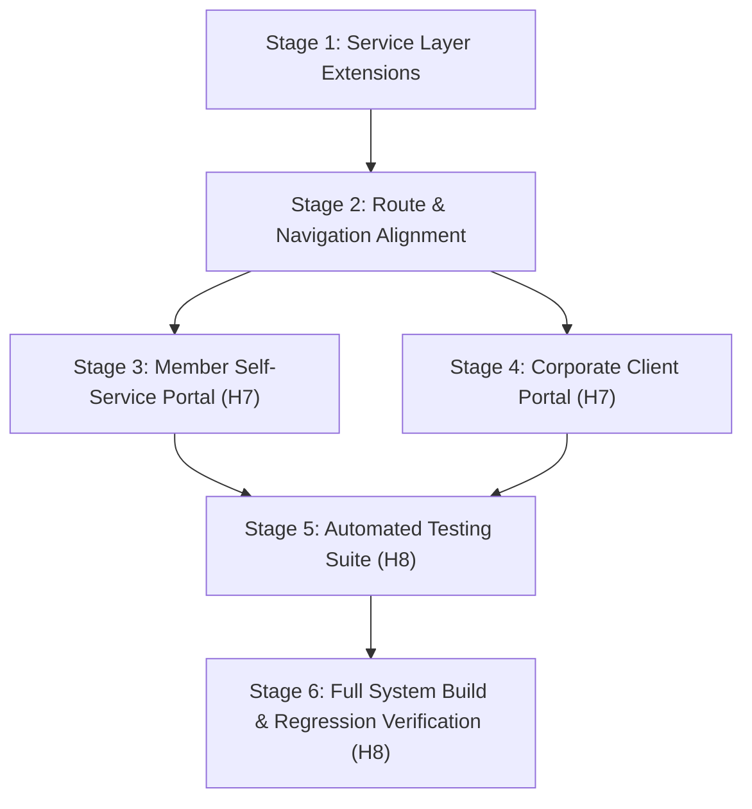

# CHAMPIONS CLUB — COMBINED MILESTONE H7 + H8
## Official Implementation & Verification Plan
### Member & Corporate Self-Service Portals, End-to-End System Integration & Regression Testing

---

## 1. Implementation Overview & Objectives

This document establishes the precise step-by-step roadmap for implementing **Milestones H7 and H8** together.

- **Milestone H7:** Delivery of production-grade self-service portals for Club Members (`/member`) and Corporate Clients (`/corporate`), allowing end-users to manage their accounts, reservations, retail orders, and financial statements without administrative intervention.
- **Milestone H8:** Comprehensive end-to-end regression testing, cross-subsystem verification, and role-based security validation across all frontend and backend flows.

---

## 2. Implementation Stages & Dependency Order



---

### Stage 1: Service Layer Extensions
**Objective:** Add clean self-service endpoint bindings to frontend service layers without modifying working methods.

1. **`frontend/src/services/financeService.js`:**
   - Add `getMyClientProfile()`:
     ```javascript
     async getMyClientProfile() {
       const res = await apiClient.get('/business-clients/me');
       return res.data;
     }
     ```
   - Add `getMyClientInvoices(params = {})`:
     ```javascript
     async getMyClientInvoices(params = {}) {
       const res = await apiClient.get('/business-clients/me/invoices', { params });
       return res.data;
     }
     ```
2. **`frontend/src/services/memberService.js`:**
   - Update `updateMyProfile(data)` to call `PUT /auth/me` (the authoritative endpoint that synchronizes both `users` and `members` tables).

---

### Stage 2: Route & Navigation Alignment
**Objective:** Grant appropriate portal access to members and corporate clients across existing self-service views.

1. **`frontend/src/routes/index.jsx`:**
   - Allow `ROLES.MEMBER` on `/bookings` (or embed bookings into `/member`).
   - Allow `ROLES.MEMBER` on `/finance/invoices` (the backend already auto-filters invoices to `member_id == current_user.member_profile.id`).
2. **`frontend/src/config/navigation.js`:**
   - Verify sidebar links for `ROLES.MEMBER` include Member Portal, Court Matrix, Friday Social Play, Membership Tiers, Shop Catalog, and Cafeteria Menu.
   - Verify sidebar links for `ROLES.BUSINESS_CLIENT` include Corporate Client Portal and Invoices Ledger.

---

### Stage 3: Member Self-Service Portal (`MemberDashboardPage.jsx`)
**Objective:** Transform `frontend/src/pages/member/MemberDashboardPage.jsx` from a static shell into a rich, tabbed personal operational workspace.

**Architecture & Subsystems:**
1. **Header & Profile Card:**
   - Displays member's name, email, phone, joined date, and current plan badge.
   - "Edit Contact Profile" button opening `UpdateProfileModal` (calls `authService.updateProfile` / `PUT /auth/me`).
   - Informative warning banner if user account has no associated member profile (handling 404).
2. **Tab 1: Active Membership & Tier Benefits:**
   - Plan Name, Duration, Start Date, Expiry Date.
   - Live discount pills: Court Discount (%), Pro-Shop Discount (%), Cafeteria Discount (%).
   - "View Subscription History" button opening modal with complete historical ledger snapshots (`GET /members/{id}/subscriptions`).
   - Renewal / Upgrade informational guidance ("Renewals processed at Front Desk").
3. **Tab 2: Court Reservations & Availability:**
   - Embedded `CourtScheduleMatrix.jsx` for date-driven 30-min slot inspection.
   - "Book Court Session" button opening `CreateBookingModal` pre-populated with member's profile and discounted fee calculation.
   - "My Bookings" table showing date, time, court, fee, status (`confirmed`, `cancelled`).
   - "Cancel" button on upcoming confirmed bookings with `ConfirmationDialog` (`POST /bookings/{id}/cancel`).
4. **Tab 3: Friday Social Play:**
   - Active social play mixer sessions cards.
   - Shows sport type, court, session time, entry fee, participant capacity bar (`count / max_capacity`).
   - One-click `Join Session` (`POST /bookings/social-sessions/{id}/join`) and `Leave` (`POST /bookings/social-sessions/{id}/leave`).
   - "View Roster" button opening participant list.
5. **Tab 4: Online Pro-Shop & Orders:**
   - Catalog browser with active products and stock indicators (`In Stock`, `Out of Stock`).
   - Simple cart ticket showing member discount deduction.
   - "Place Order" button calling `POST /shop/orders`.
   - "My Order History" table with order number, date, total, status (`pending`, `confirmed`, `completed`, `cancelled`).
   - "Cancel Ticket" action on `pending` orders (`POST /shop/orders/{id}/cancel`).
6. **Tab 5: Invoices & Receipts:**
   - Filterable invoice table (`all`, `issued`, `paid`, `partially_paid`).
   - Displays Invoice #, Date, Total Amount, Amount Paid, Outstanding Balance.
   - "View Breakdown" button opening modal with line items and GST tax detail.

---

### Stage 4: Corporate Client Portal (`CorporateDashboardPage.jsx`)
**Objective:** Transform `frontend/src/pages/corporate/CorporateDashboardPage.jsx` into a production-grade commercial accounting portal.

**Architecture & Subsystems:**
1. **Corporate Account Identity Card:**
   - Company Name, Contact Person, Email, Phone, GSTIN Tax ID, Billing Address.
   - Active/Inactive account status badge.
   - Informative warning banner if corporate account is unlinked (handling 404).
2. **Executive Financial Summary Cards:**
   - Total Invoiced Volume (sum of `total_amount` across corporate invoices).
   - Total Amount Settled (sum of `amount_paid`).
   - Net Outstanding Receivables Balance (sum of `outstanding_amount`).
3. **B2B Invoices Ledger:**
   - Filter by status (`all`, `issued`, `paid`, `partially_paid`).
   - Table columns: Invoice #, Issue Date, Due Date, Subtotal, GST Tax Amount, Total, Paid, Outstanding, Status.
   - "View Invoice" modal showing itemized line items, unit rates, quantities, and billing notes.
4. **Corporate Bookings & Inquiries Section:**
   - Institutional facility rental guidelines and event booking contact desk information.

---

### Stage 5: Automated Testing Suite (Milestone H8)
**Objective:** Implement dedicated unit and integration tests in `frontend/src/test/SelfServicePortals.test.jsx`.

**Test Cases to Implement:**
1. `renders Member Portal with linked membership plan, discounts, and expiry date`
2. `displays unlinked account warning when member profile returns 404`
3. `renders court availability schedule and allows member to book a court`
4. `lists member's personal court bookings and triggers cancellation confirmation`
5. `renders Friday Social Play sessions and allows member to join and leave`
6. `renders Pro-Shop catalog for member and submits online order with member discount`
7. `allows member to view personal invoices and view line item breakdowns`
8. `allows member to update self-service profile details (name and phone)`
9. `renders Corporate Client Portal with company profile and GSTIN`
10. `displays unlinked account warning when corporate client profile returns 404`
11. `calculates corporate financial totals (total billed, settled, outstanding)`
12. `lists corporate B2B invoices and opens itemized invoice detail modal`
13. `enforces RBAC: Member accessing /owner/dashboard is redirected to /unauthorized`
14. `enforces RBAC: Corporate Client accessing /hr/employees is redirected to /unauthorized`

---

### Stage 6: Full System Build & Regression Verification (Milestone H8)
**Objective:** Execute full system regression across the entire application.

1. **Frontend Test Suite:**
   - Execute all test suites: `cd frontend; npm run test`.
   - Verify that all 12 test suites (65+ tests) pass with 100% success rate.
2. **Frontend Production Build:**
   - Execute `cd frontend; npm run build`.
   - Verify bundling completes cleanly without warnings or errors.
3. **Backend Test Suite Regression:**
   - Run pytest suite against `champions_club_test` database to verify backend integrity: `pytest`.
4. **Git Commit & Push:**
   - Stage and commit all changes to `main` with detailed commit message.

---

## 3. Acceptance Criteria

| # | Requirement | Verification Method |
|---|---|---|
| **AC-1** | Member Portal displays live plan tier, validity period, and percentage discounts. | Automated test & UI inspection |
| **AC-2** | Members can reserve courts for themselves with member rates, and cancel reservations. | Automated test & booking service verification |
| **AC-3** | Members can join and leave Friday social sessions with live capacity updates. | Automated test & session service verification |
| **AC-4** | Members can place online shop orders with automated discount deduction. | Automated test & order service verification |
| **AC-5** | Members can view only their own invoices with outstanding balances. | Automated test & invoice service verification |
| **AC-6** | Members can update full_name and phone via self-service profile modal. | Automated test & authService verification |
| **AC-7** | Corporate Portal displays company profile, GSTIN, and corporate financial totals. | Automated test & client service verification |
| **AC-8** | Corporate Portal lists B2B invoices with itemized line items and payment statuses. | Automated test & invoice service verification |
| **AC-9** | Unlinked accounts display clear, user-friendly 404 alert banners. | Automated test & UI inspection |
| **AC-10** | Strict RBAC isolation blocks members and corporate clients from administrative views. | Automated test & route guard verification |
| **AC-11** | Zero database regressions or destructive schema modifications. | Verified against PostgreSQL database |
| **AC-12** | 100% test pass rate across all test suites and clean Vite production build. | `vitest run` & `vite build` |
