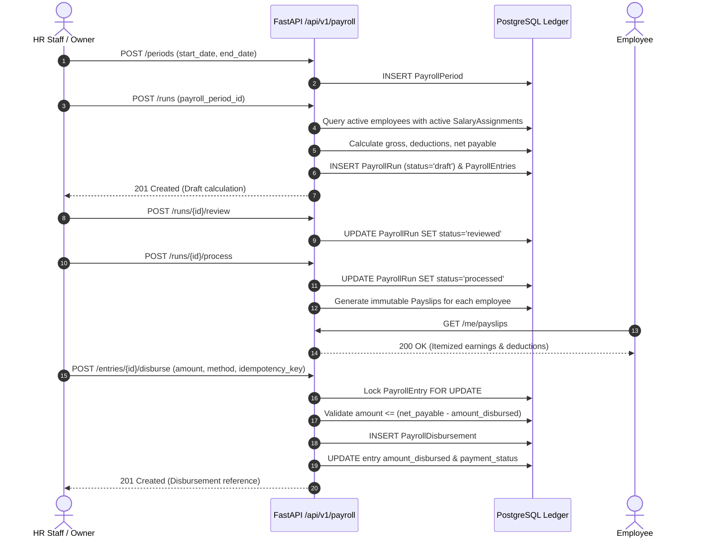

# Payroll & Compensation Workflow
## Champions Club Sports Club Management System

**Module:** `backend/app/modules/employees/`  
**Purpose:** Handles salary structures, revisions, batch payroll calculations, immutable payslips, and decoupled disbursement accounting.

---

## 1. Payroll Lifecycle

---

## 2. Mathematical Formulations & Precision

All calculations strictly use Python `Decimal` and PostgreSQL `Numeric(10, 2)` / `Numeric(12, 2)`:

1. **Gross Earnings**:
   $$\text{Gross} = \text{base\_salary} + \sum_{c \in \text{earnings}} c.\text{amount}$$
2. **Total Deductions**:
   $$\text{Total Deductions} = \sum_{c \in \text{deductions}} c.\text{amount}$$
3. **Net Payable**:
   $$\text{Net Payable} = \max\left(0, \; \text{Gross} - \text{Total Deductions}\right)$$
4. **Outstanding Balance**:
   $$\text{Outstanding Balance} = \text{Net Payable} - \text{amount\_disbursed}$$

---

## 3. Financial Decoupling & Double-Entry Principles

- **Operating Expense, Not Customer Inflow**: Employee payroll represents an internal club operating expense and liability.
- **Strict Model Separation**:
  - Customer Inflows (Milestone E): `invoices`, `payments`, `receipts`.
  - Payroll Disbursements (Milestone F): `payroll_runs`, `payroll_entries`, `payroll_disbursements`.
- **Zero Double-Counting**: Payroll disbursements credit bank/cash and debit payroll payable without contaminating customer revenue or sales analytics.
- **Idempotency Replay**: Client-provided `idempotency_key` guarantees that retrying payment submissions never debits club bank accounts twice.
